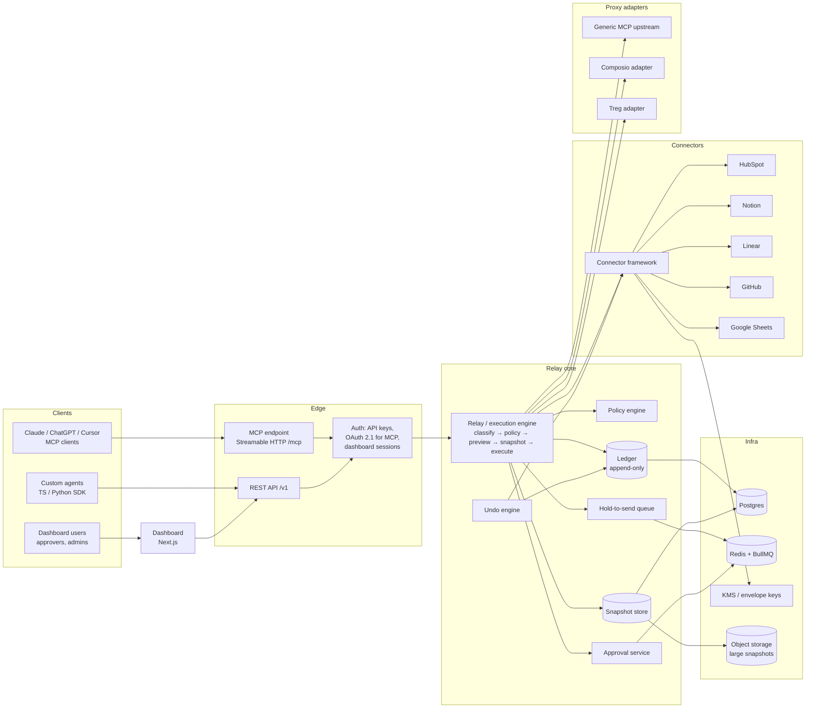
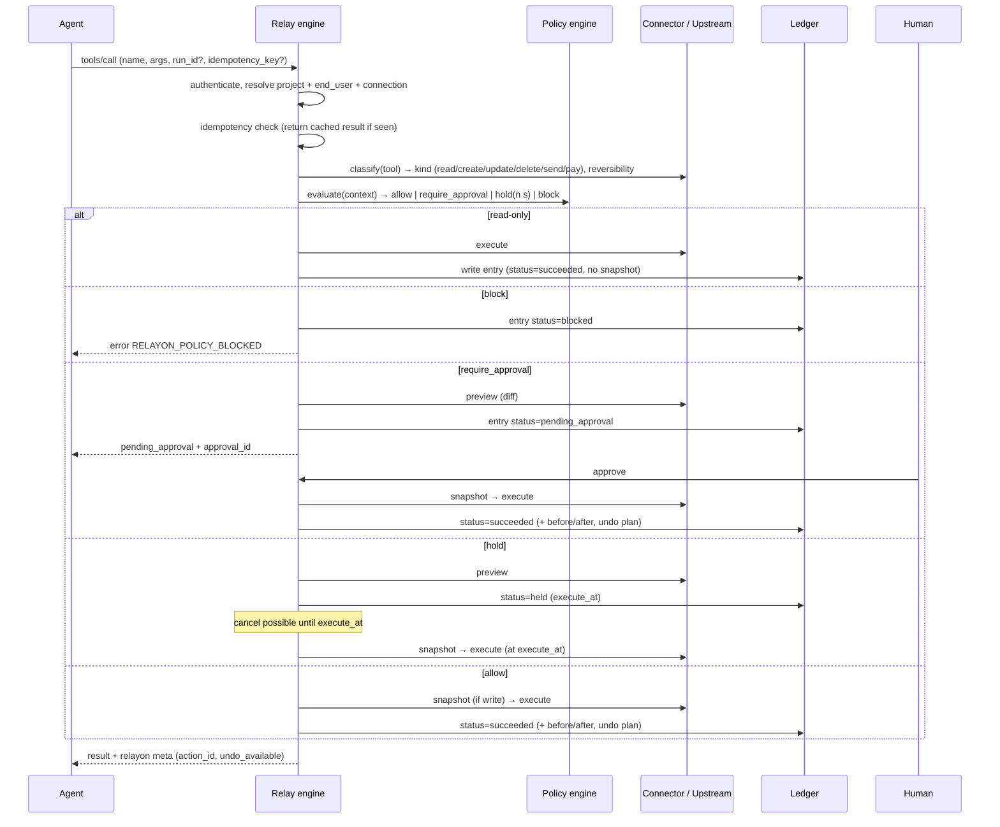
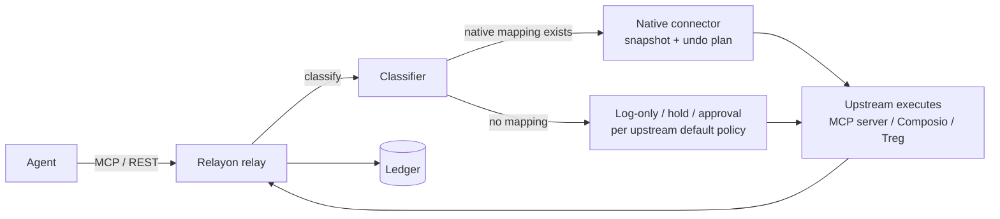
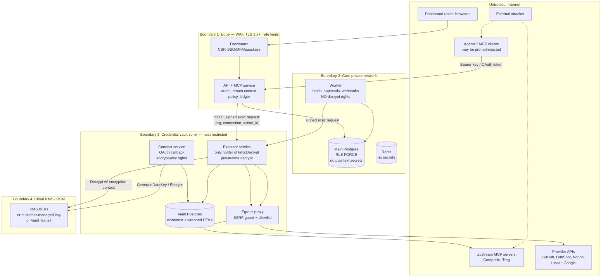

# Relayon — Build Spec / PRD (v1.0)

> **Relayon (relayon.io): the relay between AI agents and the apps they act on.**
> Every agent action is previewed, logged with cost, and either **reversible** or **held for approval**.
> Relayon has its own tool catalog and also a **proxy mode** that wraps Composio, Treg or any MCP server.

This document stands on its own. Paste it into Claude or Claude Code and build in the order in §15.
Facts about third-party APIs are cited inline with links to official docs where possible. Anything marked **UNVERIFIED** must be checked against a sandbox account before you depend on it.
Prices and tiers are **hypotheses to test**, not market data.

Date of spec: 20 Nov 2026. Owner: Anish TR.

**Code repository:** https://github.com/cosmospan/relayon. The monorepo lives at the repo root, the default branch is assumed to be `main` (check the repo), and all paths in this spec are relative to the repo root.

---

## Security principles (read first; these override convenience everywhere in this spec)

Relayon holds its customers' and their end users' OAuth tokens, refresh tokens and API keys for systems like GitHub, HubSpot and Google. If those leak, an attacker can act as thousands of people in thousands of companies. In May 2026, Composio (a direct competitor) disclosed exactly that kind of breach ([incident write-up](https://composio.dev/blog/composio-may-2026-security-incident), [credential-security rebuild](https://composio.dev/content/how-composio-rebuilt-credential-security-after-may-2026); lessons in §11.6). **Security is a release gate, not a later phase.** No milestone in §14 counts as done until its security gate passes.

| # | Principle | What it means in practice |
|---|---|---|
| P1 | **Credentials never leave the vault boundary in plaintext** | Provider tokens are decrypted only inside the isolated **Executor** service, just in time, for one outbound request. They are never returned by any API, never logged, never sent to the model, never put in a webhook or export. There is no "get token" endpoint, ever. |
| P2 | **Least privilege everywhere** | Minimum OAuth scopes per connector; per-agent scoped API keys (apps, tools, kinds, end users, IPs); IAM roles where only the Executor can call `kms:Decrypt`; internal tools are read-only by default. |
| P3 | **No runtime code from outside** | Connectors are reviewed code shipped in the build. Nothing (customers, upstreams, internal agents or LLM output) can register, upload or modify executable tool code at runtime. Proxied upstream tools execute on the upstream's servers, never in Relayon. |
| P4 | **Tenant isolation is enforced twice** | In the application (tenant derived only from the authenticated credential) **and** in Postgres (Row-Level Security with `FORCE`). A cross-tenant test suite runs on every PR. |
| P5 | **Everything from outside is untrusted data** | Tool outputs, app content, upstream tool descriptions and model text never change policy, routing, scopes or approvals. Policy acts only on structured fields. |
| P6 | **Sensitive actions need a human** | Deletes, sends, payments, permission/scope changes and anything unknown default to approval or hold. |
| P7 | **Assume breach; limit blast radius** | Per-tenant data keys, a separate vault database, short-lived tokens, bulk-revocation kill switches, canary credentials, and anomaly alerts on decrypt and token use. |
| P8 | **Tamper-evident, complete audit** | Every credential decrypt, action, approval, undo and admin change is logged in a hash-chained log that admins cannot silently edit. |
| P9 | **Secure supply chain** | Pinned dependencies, signed builds with provenance, SBOM, secret scanning with push protection, no long-lived CI secrets (OIDC). |
| P10 | **Fail closed** | If the vault, KMS, policy engine or snapshot fails, the write does not run. |

**Non-negotiables for anyone (or any AI) writing code for Relayon:**
1. Never add an endpoint, SDK method or debug path that returns a decrypted credential.
2. Never log request/response headers or bodies for provider calls without the redactor.
3. Never query a tenant table without the tenant context; never accept `org_id` from the request body.
4. Never `eval`, `new Function`, `vm.runInContext` or dynamically `import()` anything derived from input or upstream data.
5. Never fetch a URL from input or upstream metadata without the SSRF-guarded HTTP client.
6. Never commit secrets; use `.env` locally and cloud secret managers or OIDC in CI and production.

---

## Table of contents
S. Security principles (above — read first)
0. Glossary
1. Overview, goals, non-goals, personas, user stories
2. System architecture
3. Stack and monorepo layout
4. Data model
5. Connector spec and per-app undo strategies
6. Proxy mode
7. Policy engine, approvals, hold windows
8. Public APIs (MCP, REST, webhooks, errors, idempotency)
9. SDKs and framework adapters
10. Dashboard pages and UX
11. Security design (threat model, vault, isolation, Composio lessons, agent/MCP security, AppSec, ops, test checklist)
12. Billing and metering
13. Observability, testing, CI/CD
14. Build plan (weeks 1–8 + later phases)
15. How to use this doc with Claude
16. Open questions and risks
Appendix A: API facts and sources

---

## 0. Glossary

| Term | Meaning |
|---|---|
| **Action** | One tool call that an agent asks Relayon to run, for example `hubspot.update_deal`. |
| **Ledger entry** | The record of one action: who, which agent, input, preview diff, before-state, after-state, result, cost, status, undo info. |
| **Task / run** | A group of actions under one `run_id`, usually one agent task. Undo can target a whole run. |
| **Reversibility class** | `reversible` (an exact inverse exists), `compensatable` (a corrective action exists but side effects remain), `irreversible` (cannot be undone, so it must be held or approved). |
| **Snapshot** | The before-state of the target resource, captured just before execution. |
| **Hold** | A delayed execution window (for example 60 s) during which an action can be cancelled. Used for sends and payments. |
| **Approval** | A human decision (approve or reject) required by a policy before execution. |
| **Connector** | Code module for one app (HubSpot, Notion, ...) that defines tools plus snapshot/execute/undo/preview. |
| **Upstream** | An external tool source in proxy mode (any MCP server, Composio, Treg). |
| **End user** | The customer's user whose app account the agent acts on (multi-tenant). |
| **Project** | An isolated environment inside an org (for example "prod", "staging") with its own keys, connections and policies. |

---

## 1. Overview

### 1.1 Problem
AI agents now write into real systems: CRMs, issue trackers, docs, sheets, email. They make destructive mistakes. Some public examples:
- Replit's agent deleted a production database during a code freeze (Jul 2025): [The Register](https://www.theregister.com/software/2025/07/21/vibe-coding-service-replit-deleted-production-database/719783), and [Replit's response](https://replit.com/blog/doubling-down-on-our-commitment-to-secure-vibe-coding).
- A Cursor agent deleted PocketOS's production database and backups with one API call (Apr 2026): [Guardian](https://www.theguardian.com/technology/2026/apr/29/claude-ai-deletes-firm-database).
- Kiro sent an unreviewed email to an external customer by picking the "send" tool instead of the "draft" tool (May 2026): [GitHub issue #8500](https://github.com/kirodotdev/Kiro/issues/8500).

Tool platforms such as Composio, Arcade, Pipedream and Treg execute actions. Some add pre-checks (Composio Firewall) or approval pauses (Arcade), but none of them puts **undo inside every tool**.

### 1.2 Product in one paragraph
Relayon is a tool platform and gateway. Agents connect to Relayon through MCP (Streamable HTTP), REST or SDKs. Each tool call is classified, checked against policy, previewed as a diff, snapshotted, then executed, held or sent for approval. The result is recorded in an append-only ledger with cost. Any reversible action, or a whole run, can be undone in one click. Relayon ships its own curated connectors (5 apps in v1) and can also wrap any upstream MCP server, Composio or Treg ("proxy mode"). Proxied calls get logging, policies, holds and approvals, plus undo whenever Relayon has its own connector for that app.

### 1.3 Goals (v1, 8 weeks)
- **G0 (gating every other goal): security first.** Credentials are held in an isolated vault and decrypted only in the Executor, just in time. Tenant isolation is enforced in both the app and the DB. Security gates in §14 must pass at each milestone, and an external pen test must pass before launch (§11).
- G1: A remote MCP endpoint and REST API that execute tools through the relay pipeline (classify → policy → preview → snapshot → execute/hold/approve → ledger).
- G2: Native connectors for **HubSpot, Notion, Linear, GitHub, Google Sheets**, with reversibility classes and working undo for every action marked `reversible`.
- G3: One-click undo of a single action and of a whole run, newest first, with conflict detection.
- G4: Policy engine (YAML/JSON) with allow / require_approval / hold / block, plus an approvals inbox in the dashboard and a webhook.
- G5: Proxy mode for any MCP server (Streamable HTTP) and for the Composio and Treg HTTP APIs, as log + policy + hold, with undo when a native connector matches.
- G6: Dashboard with ledger timeline, diff view, undo button, approvals, policies, connections, spend.
- G7: TypeScript and Python SDKs, plus adapters for Vercel AI SDK, OpenAI Agents SDK, LangChain, CrewAI and Mastra.
- G8: Usage metering for the pricing hypotheses (protected actions, executions, ledger retention).

### 1.4 Non-goals (v1)
- A large catalog (100+ apps). That is phase 2.
- Triggers, webhooks from apps and syncs. Phase 2.
- API-owner marketplace and revenue share. Phase 3.
- Hosting LLMs or running agents. Relayon only relays tool calls.
- Undo of irreversible effects such as sent email or captured payments. These are **held or approved**, never "undone".
- Compliance certifications in v1 (stay SOC 2-ready; see §11).
- Reselling paid data providers' accounts. Read/data tools come via BYOK or the upstream's own billing.

### 1.5 Personas
1. **Agent builder (primary)**: an engineer at a 2–50 person startup shipping an agent that writes into customers' SaaS. Wants reliability, an undo button, and a log to show customers.
2. **Automation agency**: builds agents for clients in n8n, custom code or Claude. Wants per-client isolation, approvals routed to the client, and an audit trail.
3. **Power user / indie dev**: uses Claude Code, Cursor or ChatGPT with write-capable MCPs. Wants a safety net in front of the MCP servers they already use (proxy mode).
4. **Reviewer / approver**: a non-technical teammate or client who approves or rejects held actions from a link.
5. **Org admin**: manages keys, connections, policies, budgets and billing.

### 1.6 User stories and acceptance criteria

**US-1: Connect an app.** As a builder I connect HubSpot for end user `u_123` via OAuth.
- AC: `POST /v1/connections` returns an `authorize_url`. After consent, the connection status is `active` and its scopes are stored. Tokens are encrypted at rest (§11). Refresh happens automatically. A failed refresh sets `status=expired` and fires the `connection.expired` webhook.

**US-2: Run a tool through MCP.** As a builder I point Claude, Cursor or my agent at `https://mcp.relayon.io/mcp` and call `hubspot_update_deal`.
- AC: The tool appears in `tools/list` with correct `annotations` (`readOnlyHint`, `destructiveHint`). The call returns the result. A ledger entry exists with before/after state and `reversibility=reversible`. Added latency over a direct call is p50 < 150 ms excluding upstream time (target; measure).

**US-3: Preview.** As a builder I call `relayon.preview(...)`, or set `mode=dry_run`, to see the diff without executing.
- AC: The response contains a field-level diff (`before`, `after`), the reversibility class and the matched policy decision. No upstream write happens. This is verified in the connector contract tests.

**US-4: Undo one action.** As a builder or approver I click Undo on a ledger entry.
- AC: For `reversible` actions the inverse runs, and the entry gets `undo_status=undone` with a linked undo_op ledger entry. If the resource changed after the agent's write (conflict), undo stops with `conflict` and shows a 3-way diff (before / agent-after / current). A user can force undo only with the `undo:force` permission.

**US-5: Undo a run.** As a builder I undo `run_id=r_abc` in one click.
- AC: All reversible actions in the run are undone newest first. Compensatable actions are listed with their compensation and need explicit confirmation. Irreversible actions are listed as "cannot undo". The final report shows per-action results. A partial failure leaves a clear state, with no silent skips.

**US-6: Approvals.** As an admin I write a policy that requires approval for any `delete` or any `send`.
- AC: A matching call returns MCP result `status=pending_approval` with an `approval_id` (and REST 202). The approval appears in the inbox and fires the `approval.requested` webhook. Approve → executes and the ledger updates. Reject → `status=rejected`, nothing executes. Expired (default 24 h) → `status=expired`.

**US-7: Hold-to-send.** As a builder I set `hold_seconds: 60` for `gmail.send` (phase 1.5) or any proxied tool flagged as `send`.
- AC: The action enters `held_actions`. A cancel within the window means nothing executes. After the window it executes exactly once (idempotent), even across worker restarts.

**US-8: Proxy an MCP server.** As a power user I add `https://mcp.linear.app/mcp` (or any MCP URL) as an upstream with the user's own auth.
- AC: Relayon exposes the upstream's tools (namespaced `linear__*`) and classifies each one. Every call is logged and policy-checked. If a native Relayon connector maps the tool, undo is available; otherwise the entry shows "log-only".

**US-9: Proxy Composio or Treg.** As a builder I register my Composio API key or Treg token as an upstream.
- AC: Calls routed through Relayon to Composio or Treg are logged with cost (if the upstream returns it) and policy-checked. Tool names map to native connectors when possible. Credentials for upstreams are stored encrypted. The client token is **never** forwarded upstream (MCP spec; see §11).

**US-10: Spend view.** As an admin I see cost per run, per agent and per day.
- AC: Each ledger entry stores `cost_usd_micros` (Relayon fee + upstream cost when known). The dashboard aggregates by run, agent, project and day, and exports CSV.

**US-11: SDK usage.** As a builder I use `@relayon/sdk` with the Vercel AI SDK in under 10 lines.
- AC: The quickstart runs end to end against a sandbox project. Framework adapters are published for TS (Vercel AI SDK, OpenAI Agents SDK, Mastra, LangChain JS) and Python (LangChain, CrewAI, OpenAI Agents SDK).

---

## 2. System architecture



### 2.1 Request pipeline (one action)



### 2.2 Components
| Component | Responsibility |
|---|---|
| **MCP endpoint** | Streamable HTTP per the MCP spec ([transport](https://modelcontextprotocol.io/specification/2026-07-28/basic/transports/streamable-http)). Implements `initialize`, `tools/list`, `tools/call`. Supports API-key bearer auth and OAuth 2.1 with Protected Resource Metadata ([authorization](https://modelcontextprotocol.io/specification/2026-07-28/basic/authorization)). |
| **REST API** | `/v1/*` for actions, runs, undo, approvals, connections, policies, upstreams, usage. |
| **Relay engine** | The pipeline in §2.1. Stateless workers; state lives in Postgres and Redis. |
| **Connector framework** | Loads connector modules; validates input with Zod; calls snapshot/execute/undo/preview. |
| **Snapshot store** | Before/after JSON in Postgres (`snapshots`); payloads > 256 KB go to object storage with a pointer. Encrypted (§11). |
| **Policy engine** | Evaluates rules (§7) → decision + reasons. Pure function, unit-tested. |
| **Approval service** | Creates approvals, notifies (dashboard + webhook; Slack/email later), handles expiry. |
| **Hold queue** | BullMQ delayed jobs keyed by action_id; exactly-once execution through DB state transitions. |
| **Undo engine** | Builds and executes undo plans; conflict detection; newest-first for runs. |
| **Ledger** | Append-only `actions` table + `audit_events`; nothing is UPDATEd except status fields through guarded transitions. |
| **Proxy adapters** | MCP client to upstreams; HTTP adapters for Composio and Treg. |
| **Dashboard** | Next.js app (§10). |
| **Executor (isolated)** | The **only** service that can decrypt credentials. It receives signed exec requests from the relay engine/worker, decrypts just in time, calls the provider/upstream through the egress proxy, and returns a redacted response. Runs in the vault network zone (§11.2, §11.4). |
| **Connect service** | Hosts OAuth start/callback and API-key capture. It can **encrypt** (GenerateDataKey) but not decrypt. Writes to the vault DB. |
| **Vault DB** | A separate Postgres holding ciphertext credentials, wrapped per-tenant DEKs and BYO OAuth client secrets. Only the Executor and Connect service can reach it. |
| **Egress proxy** | All outbound provider/upstream/webhook traffic goes through it. Enforces domain allowlists and blocks private/metadata IPs (§11.9). |

### 2.3 Security split of the runtime
The relay engine (API + worker) decides **whether** and **what** to execute. The Executor is the only place that holds plaintext credentials, and only for one call. In the diagram above, the connector framework and proxy adapters run **inside the Executor**. See the trust-boundary diagram in §11.2. A full compromise of the API service therefore yields neither plaintext tokens nor decrypt rights.

---

## 3. Stack and monorepo layout

### 3.1 Recommended stack
| Concern | Choice | Why |
|---|---|---|
| Language | **TypeScript** everywhere (Python only for the Python SDK) | One language for connectors, server and SDK; the MCP TS SDK is mature. |
| API server | **Hono** on Node 22 | Small and fast; easy Streamable HTTP handling; runs on Node, Bun or Cloudflare later. |
| MCP | `@modelcontextprotocol/sdk` (official TS SDK) | Spec-conformant server and client (also used for proxying upstreams). |
| Dashboard | **Next.js** (App Router) + Tailwind + shadcn/ui | Fast to build; auth and pages. |
| DB | **Postgres 16** + **Drizzle ORM** | Typed SQL, migrations in code, row-level security possible. |
| Queue | **Redis + BullMQ** | Delayed jobs for holds, approval expiry, token refresh, undo jobs. |
| Validation | **Zod** | Connector input/output schemas → JSON Schema for MCP `inputSchema`. |
| Auth (dashboard) | Better Auth or Auth.js (email magic link + Google/GitHub) | Pick one; both OSS. |
| OAuth to apps | Own small OAuth client module per connector (authorization code + PKCE where supported) | Avoids an ELv2/hosted-service licence clash (Nango is ELv2, which bars offering it as a hosted service — [licence](https://raw.githubusercontent.com/NangoHQ/nango/master/LICENSE)). |
| Secrets | **Separate vault DB + isolated Executor**; envelope encryption with per-tenant DEKs via **AWS KMS** / GCP KMS / HashiCorp Vault Transit; AES-256-GCM with AAD; customer-managed keys for Enterprise | Built in week 1, not later. §11.4. |
| Egress | Egress proxy (e.g. Smokescreen) + in-process `safeFetch` | SSRF defence, §11.9. |
| Object storage | S3-compatible (S3 / R2) | Large snapshots. |
| Hosting | API + workers on **Fly.io** or **Railway** (or AWS ECS); Postgres on Neon or RDS; Redis on Upstash or ElastiCache; dashboard on Vercel | Cheap to start; move to AWS when enterprise needs VPC. |
| Observability | OpenTelemetry → Grafana Cloud / Honeycomb; Sentry for errors | §13. |
| Billing | **Stripe** Billing with usage meters | §12. |
| CI | GitHub Actions; pnpm + Turborepo | §13. |

### 3.2 Monorepo layout
Repo: `https://github.com/cosmospan/relayon` (the monorepo root is the repo root; clone with `git clone https://github.com/cosmospan/relayon.git`).
```
relayon/   # = github.com/cosmospan/relayon
├─ apps/
│  ├─ api/                 # Hono server: REST /v1 + MCP /mcp
│  │  ├─ src/
│  │  │  ├─ index.ts
│  │  │  ├─ routes/        # actions.ts runs.ts undo.ts approvals.ts connections.ts policies.ts upstreams.ts usage.ts webhooks.ts
│  │  │  ├─ mcp/           # server.ts (tools/list, tools/call), oauth-metadata.ts
│  │  │  ├─ middleware/    # auth.ts idempotency.ts rate-limit.ts tenant.ts
│  │  │  └─ lib/
│  ├─ worker/              # BullMQ workers: holds, approvals-expiry, undo-runs, webhooks-out (NO decrypt rights)
│  ├─ executor/            # ISOLATED: only service with kms:Decrypt; runs connectors + proxy adapters; token refresh
│  ├─ connect/             # OAuth start/callback + API-key capture; encrypt-only
│  └─ dashboard/           # Next.js
├─ packages/
│  ├─ core/                # relay engine, pipeline, types, errors
│  ├─ policy/              # DSL parser + evaluator
│  ├─ ledger/              # ledger write/read, audit
│  ├─ undo/                # undo planner/executor, conflict detection
│  ├─ db/                  # drizzle schema + migrations
│  ├─ crypto/              # envelope encryption, KeyProvider (AWS KMS / GCP KMS / Vault Transit / dev)
│  ├─ vault-db/            # drizzle schema + migrations for the separate vault DB
│  ├─ net/                 # safeFetch (SSRF guard), egress config, redactor
│  ├─ authz/               # RBAC permission matrix, tenant context, RLS helpers
│  ├─ connector-kit/       # Connector interface, helpers, test harness
│  ├─ connectors/
│  │  ├─ hubspot/
│  │  ├─ notion/
│  │  ├─ linear/
│  │  ├─ github/
│  │  └─ google-sheets/
│  ├─ proxy/               # mcp-upstream.ts composio.ts treg.ts classifier.ts tool-mapper.ts
│  ├─ sdk-ts/              # @relayon/sdk
│  ├─ adapters-ts/         # @relayon/vercel-ai, @relayon/openai-agents, @relayon/mastra, @relayon/langchain
│  └─ config/              # eslint, tsconfig
├─ sdks/
│  └─ python/              # relayon (PyPI) + relayon[langchain], relayon[crewai], relayon[openai-agents]
├─ tests/
│  ├─ contract/            # connector contract tests against sandboxes
│  └─ e2e/                 # undo e2e, proxy e2e
├─ examples/               # runnable framework examples (Vercel AI, OpenAI Agents, LangChain, CrewAI, Mastra)
├─ docs/                   # RELAYON_BUILD_SPEC.md (this file), security/ (threat-model.md, incident-response.md, runbooks), public docs (Mintlify or Docusaurus), llms.txt
├─ infra/                  # docker-compose.yml, fly.toml, terraform/ (later)
├─ .github/workflows/      # ci.yml, contract-nightly.yml, deploy.yml, release-sdks.yml
├─ CLAUDE.md               # pointer to docs/RELAYON_BUILD_SPEC.md (see §15)
├─ turbo.json
├─ pnpm-workspace.yaml
└─ README.md
```

### 3.3 Local setup
```bash
git clone https://github.com/cosmospan/relayon.git && cd relayon
corepack enable && pnpm install
cp .env.example .env            # fill in local values only; never commit secrets
docker compose -f infra/docker-compose.yml up -d   # Postgres 16 (main) + Postgres 16 (vault), Redis 7, MinIO, local egress proxy
pnpm db:migrate && pnpm db:seed # creates org_dev, prj_dev, a dev API key printed once
pnpm dev                        # api :8787 (REST /v1, MCP /mcp), worker, executor (dev key provider), connect, dashboard :3000
pnpm test:security              # cross-tenant suite, secret-leak grep, SSRF suite (§11.16)
```
Package names use the `@relayon/*` scope. Every workspace exposes `build`, `dev`, `lint`, `typecheck` and `test` scripts so Turborepo can run them.

---

## 4. Data model (Postgres)

Conventions:
- IDs are prefixed text IDs (`org_…`, `prj_…`, `act_…`), generated as ULIDs so they sort by time.
- Every tenant table has `org_id` and `project_id`. All queries go through a tenant-scoped repository, and Postgres Row-Level Security is a second line of defence (§11).
- `*_enc` columns hold envelope-encrypted bytes (`bytea`): `{key_id, nonce, ciphertext, tag}`.
- Times are `timestamptz` (UTC in the DB; the dashboard shows the user's zone).
- Money is `bigint` in **USD micros** (1 USD = 1,000,000).

```sql
-- ===== Tenancy & identity =====
create table orgs (
  id text primary key,                         -- org_...
  name text not null,
  plan text not null default 'free',           -- free | builder | team | enterprise
  stripe_customer_id text,
  data_region text not null default 'us',      -- us | eu (later)
  created_at timestamptz not null default now()
);

create table users (
  id text primary key,                         -- usr_...
  email citext unique not null,
  name text,
  created_at timestamptz not null default now()
);

create table org_members (
  org_id text references orgs(id) on delete cascade,
  user_id text references users(id) on delete cascade,
  role text not null check (role in ('owner','admin','developer','approver','viewer')),
  primary key (org_id, user_id)
);

create table projects (
  id text primary key,                         -- prj_...
  org_id text not null references orgs(id) on delete cascade,
  name text not null,
  environment text not null default 'production', -- production | staging | development
  default_hold_seconds int not null default 0,
  fail_mode text not null default 'closed' check (fail_mode in ('closed','open')), -- if snapshot fails
  ledger_retention_days int not null default 30,
  created_at timestamptz not null default now()
);

-- Security: also see §11.10 (key format, HMAC-SHA256 with pepper) and §11.7 (agent scoping)
create table api_keys (
  id text primary key,                         -- key_...
  org_id text not null references orgs(id) on delete cascade,
  project_id text not null references projects(id) on delete cascade,
  name text not null,
  prefix text not null,                        -- first 8 chars shown in UI, e.g. rl_live_ab12
  hash bytea not null,                         -- HMAC-SHA256(pepper, secret); secret shown once (§11.10)
  scopes text[] not null default '{actions:write,actions:read}',
  agent_name text,                             -- per-agent scoped keys (§11.7)
  allowed_apps text[], allowed_tools text[],   -- globs; null = all enabled
  max_kind text check (max_kind in ('read','create','update','delete','send','pay')),
  allowed_end_users text[],
  allowed_ips cidr[],
  last_used_ip inet,
  last_used_at timestamptz,
  expires_at timestamptz,
  revoked_at timestamptz,
  created_by text references users(id),
  created_at timestamptz not null default now()
);
create unique index on api_keys(prefix);

-- The customer's users (whose accounts agents act on)
create table end_users (
  id text primary key,                         -- eu_...
  org_id text not null, project_id text not null references projects(id) on delete cascade,
  external_id text not null,                   -- customer's own user id
  display_name text, email citext,
  metadata jsonb not null default '{}',
  created_at timestamptz not null default now(),
  unique (project_id, external_id)
);

-- ===== Connections & credentials =====
create table connections (
  id text primary key,                         -- con_...
  org_id text not null, project_id text not null references projects(id) on delete cascade,
  end_user_id text references end_users(id) on delete cascade,
  app text not null,                           -- hubspot | notion | linear | github | google_sheets | upstream:<id>
  auth_type text not null check (auth_type in ('oauth2','api_key','bearer','github_app')),
  status text not null default 'pending' check (status in ('pending','active','expired','revoked','error')),
  scopes text[] not null default '{}',
  account_label text,                          -- e.g. HubSpot portal id / Notion workspace name
  purpose text not null default 'agent' check (purpose in ('agent','undo')), -- separate undo credential (optional, §11)
  created_at timestamptz not null default now(),
  updated_at timestamptz not null default now()
);

-- !!! credentials, org_keys, oauth_clients and decrypt_log live in the SEPARATE VAULT DB (§11.4),
-- reachable only by the Executor (decrypt) and Connect service (encrypt). They are shown here for completeness.
create table credentials (
  id text primary key,                         -- cred_...
  connection_id text not null references connections(id) on delete cascade,
  org_id text not null,
  access_token_enc bytea,
  refresh_token_enc bytea,
  api_key_enc bytea,
  expires_at timestamptz,
  dek_id text not null,                        -- data-encryption key id (wrapped by KMS)
  rotated_at timestamptz,
  created_at timestamptz not null default now()
);

create table org_keys (                       -- VAULT DB; envelope encryption (§11.4)
  id text primary key,                         -- dek_...
  org_id text not null references orgs(id) on delete cascade,
  kms_key_arn text not null,                   -- KEK reference
  wrapped_dek bytea not null,
  status text not null default 'active' check (status in ('active','retired')),
  created_at timestamptz not null default now()
);

create table oauth_clients (                  -- VAULT DB; BYO OAuth apps (§11.4)
  id text primary key, org_id text not null, app text not null,
  client_id text not null, client_secret_enc bytea not null, dek_id text not null,
  created_at timestamptz not null default now()
);

create table decrypt_log (                    -- VAULT DB; append-only, every decrypt (§11.4, §11.12)
  id bigserial primary key, org_id text not null, connection_id text not null,
  action_id text, purpose text not null check (purpose in ('execute','refresh','undo','revoke')),
  executor_instance text not null, created_at timestamptz not null default now()
);

create table oauth_states (                    -- short-lived PKCE/state
  state text primary key, connection_id text not null, code_verifier_enc bytea,
  redirect_uri text not null, expires_at timestamptz not null
);

-- ===== Tools catalog =====
create table tools (
  id text primary key,                         -- e.g. hubspot.update_deal  or  upstream:ups_12/linear__create_issue
  app text not null,
  source text not null check (source in ('native','upstream_mcp','composio','treg')),
  upstream_id text,                            -- for proxied tools
  name text not null,                          -- MCP-safe name, e.g. hubspot_update_deal
  title text, description text not null,
  kind text not null check (kind in ('read','create','update','delete','send','pay','other')),
  reversibility text not null check (reversibility in ('read_only','reversible','compensatable','irreversible','unknown')),
  input_schema jsonb not null,
  output_schema jsonb,
  native_mapping text,                         -- for proxied tools: native tool id used for snapshot/undo, if any
  version text not null default '1',
  health jsonb not null default '{}',          -- rolling success rate, p50 latency (phase 2 public page)
  enabled boolean not null default true,
  updated_at timestamptz not null default now()
);

-- ===== Runs, actions (ledger) =====
create table runs (
  id text primary key,                         -- run_... (client may supply its own id; stored in external_id)
  org_id text not null, project_id text not null,
  external_id text,
  agent_name text, end_user_id text,
  status text not null default 'open' check (status in ('open','closed','undoing','undone','partially_undone')),
  started_at timestamptz not null default now(),
  closed_at timestamptz,
  total_cost_usd_micros bigint not null default 0,
  metadata jsonb not null default '{}'
);

create table actions (                         -- THE LEDGER (append-only except guarded status transitions)
  id text primary key,                         -- act_...
  org_id text not null, project_id text not null,
  run_id text references runs(id),
  parent_action_id text references actions(id),  -- set for undo/compensation actions
  end_user_id text, connection_id text,
  tool_id text not null,
  source text not null,                        -- native | upstream_mcp | composio | treg
  caller text not null,                        -- mcp | rest | sdk
  agent_name text, model text,                 -- optional, client-reported
  input jsonb not null,                        -- redacted per policy (§11)
  input_hash bytea not null,
  idempotency_key text,
  kind text not null,
  reversibility text not null,
  policy_decision text not null check (policy_decision in ('allow','require_approval','hold','block')),
  policy_rule_ids text[] not null default '{}',
  status text not null check (status in (
     'received','previewed','pending_approval','approved','rejected','expired',
     'held','cancelled','executing','succeeded','failed','blocked')),
  preview jsonb,                               -- diff shown to humans
  result jsonb,                                -- redacted upstream result
  error jsonb,
  target_ref jsonb,                            -- {app, type, id, url} of the resource touched
  snapshot_id text,
  undo_status text not null default 'none' check (undo_status in (
     'none','available','undoing','undone','conflict','failed','not_possible','compensated')),
  cost_usd_micros bigint not null default 0,   -- relayon fee + upstream cost when known
  upstream_cost_usd_micros bigint,
  latency_ms int, upstream_latency_ms int,
  created_at timestamptz not null default now(),
  executed_at timestamptz,
  prev_hash bytea, entry_hash bytea            -- hash chain for tamper evidence (§11)
);
create index on actions(project_id, created_at desc);
create index on actions(run_id, created_at desc);
create unique index on actions(project_id, idempotency_key) where idempotency_key is not null;

create table snapshots (
  id text primary key,                         -- snp_...
  action_id text not null references actions(id),
  org_id text not null,
  target_ref jsonb not null,
  before_enc bytea,                            -- encrypted JSON; null if resource did not exist (create)
  after_enc bytea,                             -- captured after execute for conflict checks
  before_etag text, after_etag text,           -- version markers when the API offers them (updated_at, sha, etc.)
  storage text not null default 'inline' check (storage in ('inline','object')),
  object_key text,
  size_bytes int,
  expires_at timestamptz not null,             -- = created_at + retention
  created_at timestamptz not null default now()
);

create table undo_ops (
  id text primary key,                         -- undo_...
  org_id text not null, project_id text not null,
  scope text not null check (scope in ('action','run')),
  action_id text, run_id text,
  requested_by text not null,                  -- usr_... or key_...
  force boolean not null default false,
  status text not null check (status in ('planned','running','succeeded','partial','failed','conflict')),
  plan jsonb not null,                         -- ordered list of steps
  report jsonb,                                -- per-step outcome
  created_at timestamptz not null default now(),
  finished_at timestamptz
);

-- ===== Policies, approvals, holds =====
create table policies (
  id text primary key,                         -- pol_...
  org_id text not null, project_id text not null,
  name text not null,
  version int not null default 1,
  source_format text not null check (source_format in ('yaml','json')),
  source text not null,                        -- raw DSL
  compiled jsonb not null,                     -- validated AST
  enabled boolean not null default true,
  priority int not null default 100,
  created_by text, created_at timestamptz not null default now()
);

create table approvals (
  id text primary key,                         -- apr_...
  org_id text not null, project_id text not null,
  action_id text not null references actions(id),
  status text not null check (status in ('pending','approved','rejected','expired','cancelled')),
  required_approvers int not null default 1,
  approver_roles text[] not null default '{approver,admin,owner}',
  decided_by text[], decided_at timestamptz,
  reason text,
  public_token_hash bytea,                     -- for one-click approve links (signed, single use)
  expires_at timestamptz not null,
  channels text[] not null default '{dashboard,webhook}',
  created_at timestamptz not null default now()
);

create table held_actions (
  action_id text primary key references actions(id),
  org_id text not null, project_id text not null,
  execute_at timestamptz not null,
  status text not null check (status in ('waiting','executing','done','cancelled','failed')),
  job_id text,                                 -- BullMQ job id
  cancelled_by text,
  created_at timestamptz not null default now()
);

-- ===== Proxy upstreams =====
create table proxy_upstreams (
  id text primary key,                         -- ups_...
  org_id text not null, project_id text not null,
  kind text not null check (kind in ('mcp','composio','treg')),
  name text not null,                          -- namespace prefix, e.g. linear
  url text,                                    -- MCP URL or API base
  auth_connection_id text references connections(id),
  default_policy text not null default 'log_only' check (default_policy in ('log_only','hold_writes','approve_writes','block_unknown')),
  tool_overrides jsonb not null default '{}',  -- per-tool kind/reversibility overrides
  last_synced_at timestamptz,
  status text not null default 'active'
);

-- ===== Usage, billing =====
create table usage_events (
  id bigserial primary key,
  org_id text not null, project_id text not null,
  action_id text,
  meter text not null check (meter in ('protected_action','execution','approval','undo','snapshot_bytes')),
  quantity bigint not null,
  occurred_at timestamptz not null default now(),
  reported_to_stripe_at timestamptz
);
create index on usage_events(org_id, occurred_at);

create table usage_daily (                     -- rollup for dashboard & invoices
  org_id text, project_id text, day date, meter text, quantity bigint,
  primary key (org_id, project_id, day, meter)
);

create table budgets (                         -- phase 2 but schema now
  id text primary key, org_id text not null, project_id text,
  scope text not null check (scope in ('project','run','agent','end_user')),
  scope_value text, period text check (period in ('run','day','month')),
  limit_usd_micros bigint not null, action_on_exceed text not null default 'require_approval'
);

-- ===== Security =====
create table security_settings (
  org_id text primary key, require_mfa boolean not null default true,
  sso_enforced boolean not null default false, cmk_key_ref text,       -- customer-managed key (Enterprise)
  ip_allowlist cidr[], session_max_hours int not null default 168
);

-- Every tenant table: ALTER TABLE <t> ENABLE ROW LEVEL SECURITY; ALTER TABLE <t> FORCE ROW LEVEL SECURITY;
-- CREATE POLICY tenant_isolation ON <t> USING (org_id = current_setting('app.org_id', true))
--   WITH CHECK (org_id = current_setting('app.org_id', true));   (§11.5)

-- ===== Webhooks & audit =====
create table webhook_endpoints (
  id text primary key, org_id text not null, project_id text not null,
  url text not null, secret_enc bytea not null,
  events text[] not null, enabled boolean not null default true
);

create table webhook_deliveries (
  id text primary key, endpoint_id text not null, event_type text not null,
  payload jsonb not null, attempt int not null default 0,
  status text not null, next_attempt_at timestamptz, last_response_code int
);

create table audit_events (                    -- human/admin activity (not agent actions)
  id bigserial primary key,
  org_id text not null, project_id text,
  actor text not null,                         -- usr_ / key_ / system
  event text not null,                         -- key.created, policy.updated, undo.forced, approval.decided, connection.revoked ...
  target text, data jsonb not null default '{}',
  ip inet, user_agent text,
  created_at timestamptz not null default now()
);

create table idempotency_keys (
  project_id text not null, key text not null,
  request_hash bytea not null, response jsonb, status_code int,
  created_at timestamptz not null default now(),
  primary key (project_id, key)
);                                             -- TTL 24h via cron
```

### 4.1 Action state machine
```
received → previewed → (block) blocked
                    → (allow) executing → succeeded | failed
                    → (hold) held → executing | cancelled
                    → (require_approval) pending_approval → approved → executing
                                                         → rejected | expired
```
Transitions use `UPDATE … WHERE id=$1 AND status=$expected`. If no row is updated, another worker already moved the action, so stop. This gives exactly-once execution for holds and approvals.

---

## 5. Connector specification

### 5.1 Interface (TypeScript)

```ts
// packages/connector-kit/src/types.ts
import { z } from "zod";

export type Kind = "read" | "create" | "update" | "delete" | "send" | "pay" | "other";
export type Reversibility = "read_only" | "reversible" | "compensatable" | "irreversible" | "unknown";

export interface TargetRef { app: string; type: string; id?: string; url?: string; parentId?: string }

export interface Ctx {
  http: HttpClient;                 // auth injected, retries, rate-limit aware
  connection: { id: string; scopes: string[]; accountLabel?: string };
  logger: Logger;
  signal: AbortSignal;
}

export interface Snapshot<B = unknown> {
  target: TargetRef;
  before: B | null;                 // null when resource does not exist yet (create)
  version?: string;                 // etag / updated_at / sha
}

export interface Diff {             // shown in dashboard + returned by preview
  target: TargetRef;
  op: "create" | "update" | "delete" | "send" | "other";
  fields: Array<{ path: string; before: unknown; after: unknown }>;
  summary: string;                  // "Change deal 'Acme' stage: qualified → closedwon"
}

export interface UndoPlan {         // stored in actions/undo_ops
  steps: Array<{ tool: string; input: unknown; description: string }>;
  kind: "inverse" | "compensation";
  caveats?: string[];               // e.g. "Notifications already sent cannot be recalled"
}

export interface ToolDef<I extends z.ZodTypeAny, O = unknown> {
  id: string;                       // "hubspot.update_deal"
  app: string;
  title: string;
  description: string;              // written for LLMs: when to use, when NOT to use
  kind: Kind;
  reversibility: Reversibility;
  input: I;
  annotations?: { readOnlyHint?: boolean; destructiveHint?: boolean; idempotentHint?: boolean; openWorldHint?: boolean };
  resolveTarget(input: z.infer<I>, ctx: Ctx): Promise<TargetRef>;
  preview?(input: z.infer<I>, snap: Snapshot | null, ctx: Ctx): Promise<Diff>;
  snapshot?(target: TargetRef, ctx: Ctx): Promise<Snapshot>;
  execute(input: z.infer<I>, ctx: Ctx): Promise<{ output: O; target: TargetRef; after?: unknown; version?: string }>;
  planUndo?(args: { input: z.infer<I>; before: Snapshot; output: O; target: TargetRef }): UndoPlan;
  conflictCheck?(args: { target: TargetRef; afterVersion?: string; after?: unknown }, ctx: Ctx):
    Promise<{ conflict: boolean; current?: unknown; changedFields?: string[] }>;
}

export function defineTool<I extends z.ZodTypeAny, O>(t: ToolDef<I, O>) { return t; }

export interface ConnectorDef {
  app: string;
  displayName: string;
  auth: OAuth2Config | ApiKeyConfig | GitHubAppConfig;
  rateLimit: { strategy: "token_bucket"; capacity: number; refillPerSec: number; scope: "connection" | "app" };
  tools: ToolDef<any, any>[];
}
```

**Rules every connector must follow**
1. `snapshot()` must read the **exact fields** that `execute()` will change. It does not need to read the whole object.
2. If `snapshot()` fails and the project has `fail_mode=closed` (the default), the action is **not executed** and the error `RELAYON_SNAPSHOT_FAILED` is returned.
3. `execute()` passes the Relayon idempotency key to the upstream when the upstream supports one.
4. Undo steps call ordinary tools of the same connector, so undo is itself logged as actions with `parent_action_id`.
5. `conflictCheck()` compares the current resource with the post-execute state (`after`/`version`). If a human changed an affected field since, undo stops with `conflict`.
6. Tool descriptions are short and say what the tool **does not** do. Tool counts per app stay small (5–12), and long tail operations go behind a generic `request` tool that is classified `unknown` and held by default.

### 5.2 Example: HubSpot update deal

```ts
export const updateDeal = defineTool({
  id: "hubspot.update_deal", app: "hubspot", title: "Update a HubSpot deal",
  description: "Update properties of one existing deal by id. Does not create or delete deals.",
  kind: "update", reversibility: "reversible",
  input: z.object({ dealId: z.string(), properties: z.record(z.string(), z.string().nullable()) }),
  annotations: { readOnlyHint: false, destructiveHint: false, idempotentHint: true },
  async resolveTarget(i) { return { app: "hubspot", type: "deal", id: i.dealId }; },
  async snapshot(t, ctx) {
    // Read only the properties we will change (passed via ctx-scoped input cache)
    const props = Object.keys(ctx.input.properties).join(",");
    const r = await ctx.http.get(`/crm/v3/objects/deals/${t.id}?properties=${props},hs_lastmodifieddate`);
    return { target: t, before: r.properties, version: r.properties.hs_lastmodifieddate };
  },
  async preview(i, snap) {
    return { target: snap!.target, op: "update", summary: `Update deal ${i.dealId}`,
      fields: Object.entries(i.properties).map(([k, v]) => ({ path: k, before: (snap!.before as any)?.[k] ?? null, after: v })) };
  },
  async execute(i, ctx) {
    const r = await ctx.http.patch(`/crm/v3/objects/deals/${i.dealId}`, { properties: i.properties });
    return { output: r, target: { app: "hubspot", type: "deal", id: i.dealId }, after: r.properties, version: r.properties.hs_lastmodifieddate };
  },
  planUndo({ input, before }) {
    const restore = Object.fromEntries(Object.keys(input.properties).map(k => [k, (before.before as any)?.[k] ?? ""]));
    return { kind: "inverse", steps: [{ tool: "hubspot.update_deal", input: { dealId: input.dealId, properties: restore }, description: "Restore previous values" }] };
  },
  async conflictCheck({ target, after }, ctx) {
    const keys = Object.keys(after as object).filter(k => k !== "hs_lastmodifieddate");
    const cur = await ctx.http.get(`/crm/v3/objects/deals/${target.id}?properties=${keys.join(",")}`);
    const changed = keys.filter(k => (cur.properties[k] ?? null) !== ((after as any)[k] ?? null));
    return { conflict: changed.length > 0, current: cur.properties, changedFields: changed };
  },
});
```
(Note: `ctx.input` is a framework helper that exposes the validated input to `snapshot`.)

### 5.3 Per-app tool sets and undo strategies (v1)

Legend: **R** = reversible, **C** = compensatable, **H** = irreversible → hold/approval by default.

#### HubSpot (CRM v3 REST)
| Tool | Class | Snapshot | Undo |
|---|---|---|---|
| `search_*`, `get_*` (contacts, companies, deals) | read | – | – |
| `create_contact/company/deal` | R | none (did not exist) | archive the created object (`DELETE /crm/v3/objects/{type}/{id}`) |
| `update_contact/company/deal` | R | changed properties + `hs_lastmodifieddate` | PATCH the previous values |
| `associate` / `disassociate` | R | existing associations | inverse association call |
| `create_note` / `create_task` | R | none | archive |
| `delete_*` (archive) | **H** | full object + associations | No public API restore found. The docs say DELETE "moves the object to the recycling bin" ([docs](https://developers.hubspot.com/docs/api-reference/legacy/crm/objects/objects/delete-object)), and restoring within 90 days is described as an in-app action ([community](https://community.hubspot.com/t/query-regarding-deleated-records/104694)). Default: require approval. Fallback "compensation": re-create from the snapshot (new id; associations re-linked; history lost) — this is labelled clearly as **not a true undo**. |
| `merge_*` | **H** | both objects | No reliable inverse. Approval only. |

Limits: burst 100 requests per 10 s per app (Free/Starter), 190 per 10 s (Pro/Enterprise); daily 250k / 625k / 1M depending on tier ([usage guidelines](https://developers.hubspot.com/docs/developer-tooling/platform/usage-guidelines)). Budget: snapshot + execute ≈ 2× read/write calls. Undo of a run with N updates = N writes.

#### Notion (REST, `Notion-Version: 2026-03-11`)
| Tool | Class | Snapshot | Undo |
|---|---|---|---|
| `search`, `get_page`, `query_database` | read | – | – |
| `create_page` (in page or database) | R | none | `PATCH /v1/pages/{id}` `{"in_trash": true}` ([trash a page](https://developers.notion.com/reference/trash-page)) |
| `update_page_properties` | R | changed properties | PATCH previous property values |
| `append_blocks` | R | none (new block ids recorded) | delete (trash) the appended blocks |
| `update_block` | R | the block | PATCH previous block content |
| `trash_page` | R | page metadata | PATCH `{"in_trash": false}` |
| `delete_block` | R* | block + children (recursive read) | Restoring a trashed block: UNVERIFIED whether `in_trash:false` works for blocks the same way as pages. Until verified, re-create from the snapshot (new ids) and mark as compensation. |
| `move_page` | R | old parent | move back |

Notes: `archived` was replaced by `in_trash` in API version 2026-03-11 ([upgrade guide](https://developers.notion.com/guides/get-started/upgrade-guide-2026-03-11)). Rate limit averages 3 requests per second per integration ([request limits](https://developers.notion.com/reference/request-limits)); handle 429 with `Retry-After`. Rich text over 2,000 chars and other size limits apply (see the same page).

#### Linear (GraphQL `https://api.linear.app/graphql` — [docs](https://linear.app/developers/graphql))
| Tool | Class | Snapshot | Undo |
|---|---|---|---|
| `search_issues`, `get_issue`, `list_teams` | read | – | – |
| `create_issue` | R | none | `issueArchive` (preferred) or `issueDelete` (moves to trash) |
| `update_issue` (title, description, state, assignee, labels, priority, estimate, project, cycle) | R | changed fields + `updatedAt` | `issueUpdate` with the previous values |
| `create_comment` | R | none | `commentDelete` |
| `update_comment` | R | body | `commentUpdate` previous body |
| `archive_issue` | R | – | `issueUnarchive` |
| `delete_issue` | **H** until verified | full issue | Linear says deleted issues go to "Recently deleted" for 30 days and can be restored in the app ([docs](https://linear.app/docs/delete-archive-issues)). Whether the **API** can restore a trashed issue is **UNVERIFIED** (sources conflict). Test `issueUnarchive` on a trashed issue in a sandbox workspace. If it works, reclassify as R. |

Limits for API-key auth: 2,500 requests per hour, 3,000,000 complexity points per hour, max 10,000 complexity per query ([rate limiting](https://linear.app/developers/rate-limiting)). OAuth apps have their own limits (same page).

#### GitHub (REST + GraphQL)
| Tool | Class | Snapshot | Undo |
|---|---|---|---|
| `search_issues`, `get_issue`, `list_prs`, `get_file` | read | – | – |
| `create_issue` | C | none | Close the issue as "not planned" with a comment (REST `PATCH` state). The REST API has no issue delete ([issues REST](https://docs.github.com/en/rest/issues/issues)). True deletion uses GraphQL `deleteIssue` and needs admin rights and an org setting ([GraphQL](https://docs.github.com/en/graphql/reference/issues), [deleting an issue](https://docs.github.com/en/issues/tracking-your-work-with-issues/administering-issues/deleting-an-issue)). Notifications already sent cannot be recalled → class C. |
| `update_issue` (title, body, labels, assignees, state, milestone) | R | changed fields | PATCH the previous values |
| `create_comment` | C | none | delete the comment (`DELETE /repos/{o}/{r}/issues/comments/{id}`); notification already sent |
| `update_comment` | R | body | restore body |
| `create_branch` | R | none | delete ref |
| `create_or_update_file` (on a non-default branch) | R | previous blob sha + content | commit restoring previous content (or delete if new) |
| `create_or_update_file` on default/protected branch | **H** | same | approval; undo = revert commit |
| `create_pull_request` | C | none | close PR + delete head branch if Relayon created it |
| `merge_pull_request` | **H** | – | approval; compensation = revert PR (manual) |
| `delete_branch` | R | ref sha | recreate ref at the same sha (works while the commit still exists) |

Limits: authenticated REST 5,000 requests per hour per user (GitHub App installations scale higher), plus secondary rate limits on content creation. See [REST rate limits](https://docs.github.com/en/rest/using-the-rest-api/rate-limits-for-the-rest-api). Use a GitHub App rather than OAuth app for org installs.

#### Google Sheets (Sheets API v4)
| Tool | Class | Snapshot | Undo |
|---|---|---|---|
| `read_range`, `get_spreadsheet` | read | – | – |
| `update_range` (values) | R | values **and formulas** of the target range (`valueRenderOption=FORMULA`) | write the snapshot back to the same range |
| `append_rows` | R | none (record `updates.updatedRange`) | clear (or delete rows of) the appended range, after conflict check |
| `clear_range` | R | values+formulas of the range | write back |
| `add_sheet` | R | none | `deleteSheet` (conflict check: still empty?) |
| `delete_sheet` | **H** | full sheet values (formats best-effort) | re-create from the snapshot — formatting, charts, protections may be lost → labelled compensation |
| `batch_update` (formatting etc.) | unknown → **H** | – | approval |

Why cell snapshots and not Drive revisions: the Drive API cannot restore a native Google Sheets revision. `revisions.list` may be incomplete for Docs editors files, and `keepForever`/download apply to binary files only ([revisions reference](https://developers.google.com/workspace/drive/api/reference/rest/v3/revisions), [manage revisions guide](https://developers.google.com/workspace/drive/api/guides/manage-revisions)). A known workaround is exporting a revision via `exportLinks` and re-uploading ([Stack Overflow](https://stackoverflow.com/questions/60149716/restoring-specific-version-of-spreadsheet-using-the-google-api)), but it is lossy, so do not depend on it.
Limits: 300 read and 300 write requests per minute per project, and 60 per minute per user per project ([limits](https://developers.google.com/workspace/sheets/api/limits)). Snapshot + write uses 1 read + 1 write per action.
OAuth scope: `https://www.googleapis.com/auth/spreadsheets` is a **sensitive** scope (Google verification required, but not the CASA assessment that **restricted** scopes such as Gmail need). Verify the current classification during app verification. Alternative: `drive.file` (per-file access, non-sensitive) for a lighter verification path.

#### Phase 1.5: holds for send-type apps (no undo exists)
| App | Tool | Class | Strategy |
|---|---|---|---|
| Gmail | `send_email` | **H** | Default: create a **draft** (`users.drafts.create`) and send only after approval or hold expiry. Gmail has no unsend API ([Gmail API reference](https://developers.google.com/workspace/gmail/api/reference/rest)). Restricted scopes need a yearly CASA security assessment; third-party estimates are about $499–$5,400 per year (Secusy estimate, not official). Plan the cost before launching Gmail. |
| Slack | `post_message` | C | Hold window by default. Compensation: `chat.delete` works on messages posted by the same bot token ([chat.delete](https://docs.slack.dev/reference/methods/chat.delete)); readers may already have seen it. |
| Stripe | `create_refund`, `create_charge` | **H** | Approval only. A charge's compensation is a refund ([refunds](https://docs.stripe.com/refunds)), which is not a true undo (fees, customer statements). |
| Salesforce | `delete_record` | R (≤ 15 days) | SOAP `undelete()` restores from the Recycle Bin ([undelete](https://developer.salesforce.com/docs/atlas.en-us.api.meta/api/sforce_api_calls_undelete.htm)). |

### 5.4 Connector generation (phase 2 accelerators)
- Allowed sources to port or learn from: Activepieces pieces (MIT, except `ee/` folders — check each file's header), the GitHub MCP server (MIT), FastMCP (Apache-2.0), openapi-mcp-generator (MIT).
- Do **not** copy: Nango (ELv2, forbids offering as a hosted/managed service), n8n (Sustainable Use License), or Treg source code without written permission.
- Generator flow: OpenAPI spec → draft tools → a human picks 5–12 tools per app → write snapshot/undo by hand → contract tests must pass before `enabled=true`.

---

## 6. Proxy mode

Goal: get value on day one for people who already use other tool platforms. Relayon sits in front of them, and every call gets a ledger entry, policies, holds and approvals. Calls also get undo when Relayon has a native connector for the same app.

### 6.1 Flow


### 6.2 Upstream types
| Type | How Relayon calls it | Auth to upstream | Notes |
|---|---|---|---|
| **Generic MCP** (Streamable HTTP) | Official MCP TS SDK client; `tools/list` cached and re-synced every 10 min, or on list-change notifications (in MCP 2026-07-28 these arrive on a `subscriptions/listen` response stream; check against the spec). Description/schema hashes are pinned (§11.7) | A per-upstream credential stored in `connections` (OAuth or bearer). **Never** forward the agent's Relayon token: the MCP spec forbids token passthrough ([security considerations](https://modelcontextprotocol.io/specification/2026-07-28/basic/authorization/security-considerations)). | Tools are re-exposed as `<upstream_name>__<tool>`. |
| **Composio** | Composio's REST "execute tool" endpoint with the customer's Composio API key | Customer's key (BYOK), encrypted | Check endpoint paths and payloads against the current Composio API reference at build time (**UNVERIFIED** in this spec). |
| **Treg** | treg.to HTTP API / MCP with the customer's token; pass `X-Treg-Meta` for pass-through billing metadata | Customer's token | Use only the hosted API, not Treg's source code. Check headers against Treg docs at build time. |

### 6.3 Classification (order of precedence)
1. **Manual override** in `proxy_upstreams.tool_overrides` (set in the dashboard).
2. **Native mapping table** (`packages/proxy/src/tool-mapper.ts`): a map from known upstream tool names to native tool ids, plus an argument transformer. Examples:
   - `linear__create_issue` (Linear MCP) → `linear.create_issue`
   - `GITHUB_CREATE_AN_ISSUE` (Composio) → `github.create_issue`
   - `notion__notion-update-page` → `notion.update_page_properties`

   When mapped, Relayon runs the **native** `snapshot()` before forwarding the call upstream, then stores the native `planUndo()`. The undo runs through the **native** connector using a Relayon-held connection for that app. If no such connection exists, undo is shown as "connect HubSpot to enable undo".
3. **Annotations** from the upstream (`readOnlyHint`, `destructiveHint`). These are hints only and are not trusted for safety: the MCP blog notes annotations are not a security mechanism ([tool annotations post](https://blog.modelcontextprotocol.io/posts/2026-03-16-tool-annotations/)). Use them to *raise* caution, never to lower it below the upstream default.
4. **Name heuristics**: verbs such as `delete|remove|destroy|drop|purge` → delete; `send|post|publish|email|message|reply` → send; `pay|charge|refund|transfer|payout` → pay; `get|list|search|read|fetch|query` → read.
5. Otherwise the kind is `other` and reversibility is `unknown`.

Default policy for unknown or unmapped writes is `proxy_upstreams.default_policy`. The recommended default is `hold_writes` with a 30 s hold, and `require_approval` for delete, send and pay.

### 6.4 Result handling
- Cost: if the upstream returns cost metadata, store it in `upstream_cost_usd_micros`; otherwise leave it null (never estimate silently).
- Errors are normalised to Relayon error codes (§8.4), and the upstream body is kept in `error.upstream`.
- Upstream output is **untrusted content** (§11.7). It is passed back to the agent unchanged, but never interpreted by Relayon as instructions or policy.

---

## 7. Policy engine, approvals and hold windows

### 7.1 Evaluation model
- Policies are evaluated per action against a context: `{project, environment, end_user, agent_name, run, tool{id,app,kind,reversibility,source}, input, preview.diff, cost, time}`.
- Each rule yields `allow | require_approval | hold | block`. The **most restrictive** decision wins (`block > require_approval > hold > allow`), and all matched rule ids are stored.
- Default when no rule matches: reads → allow; reversible writes → allow; compensatable → hold 30 s; irreversible or unknown → require_approval. Orgs can change these defaults.
- The evaluator is a pure function (`packages/policy`) with a small expression language (CEL-like subset: `==, !=, in, contains, startsWith, >, <, &&, ||, !`, plus helpers `count_runs_actions(kind)`, `diff.changed(path)`). Never use `eval`.

### 7.2 YAML example
```yaml
version: 1
name: production-safety
rules:
  - id: block-hubspot-merges
    match: { tool: "hubspot.merge_*" }
    decision: block
    message: "Merges are not allowed for agents."

  - id: approve-deletes-and-sends
    match: { kind: [delete, send, pay] }
    decision: require_approval
    approval:
      approvers: { roles: [approver, admin] }
      required: 1
      expires_in: 24h
      notify: [dashboard, webhook]        # slack, email: phase 2

  - id: hold-external-github-comments
    match: { tool: "github.create_comment" }
    when: 'input.repo.startsWith("public-")'
    decision: hold
    hold_seconds: 60

  - id: big-deal-change
    match: { tool: "hubspot.update_deal" }
    when: 'diff.changed("amount") && number(input.properties.amount) > 50000'
    decision: require_approval

  - id: bulk-guard
    match: { kind: [update, delete] }
    when: 'run.count(kind in ["update","delete"]) > 25'
    decision: require_approval
    message: "More than 25 writes in one run."

  - id: unknown-proxy-tools
    match: { source: [upstream_mcp, composio, treg], reversibility: unknown }
    decision: hold
    hold_seconds: 30

  - id: staging-free
    match: { environment: development }
    decision: allow
    priority: 10                          # lower = evaluated first; still most-restrictive-wins
```

### 7.3 JSON equivalent (one rule)
```json
{
  "version": 1,
  "name": "production-safety",
  "rules": [
    {
      "id": "approve-deletes-and-sends",
      "match": { "kind": ["delete", "send", "pay"] },
      "decision": "require_approval",
      "approval": { "approvers": { "roles": ["approver", "admin"] }, "required": 1, "expires_in": "24h", "notify": ["dashboard", "webhook"] }
    }
  ]
}
```

### 7.4 Approval flow
1. The engine creates the `actions` row (`pending_approval`) with a preview diff, plus an `approvals` row.
2. Notifications go out through the dashboard inbox, the webhook `approval.requested` and (phase 2) Slack interactive messages and email with signed one-click links (single-use token, 15 min after open, plus re-auth for high-risk tools).
3. The agent receives (MCP) a tool result with `isError: false` and structured content `{status:"pending_approval", approval_id, poll_url, expires_at}`, plus a text line telling the model to wait or continue other work. With REST, the agent gets **202 Accepted**.
4. The agent (or SDK) can `GET /v1/actions/{id}` or `relayon_wait_for_action` (MCP tool, long-poll up to 60 s), or subscribe to the `action.completed` webhook.
5. On approve, the snapshot is taken **at approval time** (not request time), then execution follows. The approver can **edit the input** if the policy allows `editable: true`; the edited input is stored as a new revision.
6. On reject or expiry, nothing runs, and the agent receives `rejected` with the reason.
7. Separation of duties: the API key that requested an action can never approve it. Approver ≠ requester for human users when `require_distinct_approver: true`.

### 7.5 Hold windows
- `hold_seconds` comes from the rule, else the project default.
- A BullMQ delayed job fires at `execute_at`. The worker performs a guarded transition `held → executing`. Cancel performs `held → cancelled`, and only one can win.
- If Redis loses the job, a sweeper every 30 s picks `held_actions` with `execute_at < now() - 10s` and `status=waiting`.
- Cancel paths: dashboard button, `POST /v1/actions/{id}/cancel`, MCP tool `relayon_cancel_action`.

---

## 8. Public APIs

Base URLs (proposed): REST `https://api.relayon.io/v1`, MCP `https://mcp.relayon.io/mcp`. (relayon.io currently has no /docs, /pricing or /mcp pages; they are to be built.)

### 8.1 Authentication
- REST: `Authorization: Bearer rl_live_…` (project API key). Dashboard sessions use cookies.
- MCP:
  - (a) For agents and SDKs: `Authorization: Bearer rl_live_…`, plus header `Relayon-End-User: <external_id>` to select whose connections to use.
  - (b) For Claude, ChatGPT and other end-user clients: OAuth 2.1 per the MCP authorization spec. Serve `/.well-known/oauth-protected-resource` (RFC 9728) and return `WWW-Authenticate` with the resource metadata URL on 401; validate the token **audience** = `https://mcp.relayon.io/mcp` ([authorization](https://modelcontextprotocol.io/specification/2026-07-28/basic/authorization)).
- Optional `Relayon-Run-Id` header (or `run_id` argument) groups actions into a run. MCP 2026-07-28 removed protocol-level sessions ([Streamable HTTP](https://modelcontextprotocol.io/specification/2026-07-28/basic/transports/streamable-http)). If no run id is given, Relayon creates one and returns it in `_meta.relayon.run_id` for the client to send back. Run ids are state handles bound server-side to the authenticated principal and never used as authentication (§11.8).
- Validate the `Origin` header on every MCP request (403 if present and invalid) and validate token audience/issuer/expiry (§11.8).

### 8.2 MCP tools exposed
Native and proxied app tools are listed (filtered by the project's enabled apps, the end user's active connections, and an optional `toolsets` query param, e.g. `/mcp?toolsets=hubspot,linear`). Plus these Relayon meta tools:

| Tool | Purpose |
|---|---|
| `relayon_search_tools` | Search the catalog by intent ("update a deal amount") and return the top 5 tool schemas. Keeps `tools/list` small. |
| `relayon_preview` | Dry-run any tool: returns diff, reversibility and policy decision. |
| `relayon_undo` | Undo an action id or the current run (respects policy: undo can itself need approval). |
| `relayon_wait_for_action` | Long-poll a pending or held action. |
| `relayon_cancel_action` | Cancel a held action. |
| `relayon_list_actions` | Recent ledger entries for this run/session. |

Every tool result includes `_meta.relayon = {action_id, run_id, status, reversibility, undo_available, cost_usd}` in structured content, so agents and humans can reference it.

### 8.3 REST endpoints

| Method | Path | Purpose |
|---|---|---|
| GET | `/v1/tools` | List tools (filters: app, kind, source) |
| POST | `/v1/tools/search` | Semantic + keyword search |
| POST | `/v1/actions` | Execute a tool |
| POST | `/v1/actions/preview` | Dry run |
| GET | `/v1/actions/{id}` | Get action (status, diff, result) |
| GET | `/v1/actions` | List/filter ledger (run_id, tool, status, since, end_user) |
| POST | `/v1/actions/{id}/cancel` | Cancel a held action |
| POST | `/v1/actions/{id}/undo` | Undo one action |
| POST | `/v1/runs` | Open a run (optional) |
| GET | `/v1/runs/{id}` | Run with actions and cost |
| POST | `/v1/runs/{id}/undo` | Undo a run |
| GET | `/v1/undo-ops/{id}` | Undo progress/report |
| GET | `/v1/approvals` | List approvals |
| POST | `/v1/approvals/{id}/approve` | Approve (optional `edited_input`) |
| POST | `/v1/approvals/{id}/reject` | Reject with reason |
| POST | `/v1/end-users` | Upsert end user |
| POST | `/v1/connections` | Start a connection (returns `authorize_url`) or store an API key |
| GET | `/v1/connections` | List |
| DELETE | `/v1/connections/{id}` | Revoke (also revokes at provider where supported) |
| CRUD | `/v1/policies` | Manage policies; `POST /v1/policies/validate`; `POST /v1/policies/simulate` (run against the last 7 days of ledger) |
| CRUD | `/v1/upstreams` | Proxy upstreams; `POST /v1/upstreams/{id}/sync` |
| CRUD | `/v1/webhooks` | Webhook endpoints |
| GET | `/v1/usage` | Usage by meter/day |
| GET | `/v1/exports/actions.csv` | Ledger export |

**Example: execute**
```http
POST /v1/actions
Authorization: Bearer rl_live_xxx
Idempotency-Key: 6f1c2a90-2b7e-4c1d-9d1f-0d7d4c8e9a11
Content-Type: application/json

{
  "tool": "hubspot.update_deal",
  "end_user": "cust_42",
  "run_id": "run_01JD3…",
  "agent_name": "sales-followup-bot",
  "input": { "dealId": "18273645", "properties": { "dealstage": "closedwon", "amount": "12000" } }
}
```
```http
200 OK
{
  "id": "act_01JD3Z…",
  "status": "succeeded",
  "tool": "hubspot.update_deal",
  "reversibility": "reversible",
  "policy": { "decision": "allow", "rules": [] },
  "preview": {
    "op": "update",
    "summary": "Update deal 18273645",
    "fields": [
      { "path": "dealstage", "before": "qualifiedtobuy", "after": "closedwon" },
      { "path": "amount", "before": "9000", "after": "12000" }
    ]
  },
  "result": { "id": "18273645", "properties": { "dealstage": "closedwon", "amount": "12000" } },
  "undo": { "available": true, "url": "/v1/actions/act_01JD3Z…/undo" },
  "cost_usd": 0.0,
  "created_at": "2026-11-20T17:46:00Z"
}
```

**Example: approval required**
```http
202 Accepted
{
  "id": "act_01JD40…",
  "status": "pending_approval",
  "approval": { "id": "apr_01JD40…", "expires_at": "2026-11-21T17:46:00Z", "url": "https://app.relayon.io/approvals/apr_01JD40…" },
  "preview": { "op": "delete", "summary": "Delete contact jane@acme.com", "fields": [] },
  "policy": { "decision": "require_approval", "rules": ["approve-deletes-and-sends"] }
}
```

**Example: undo a run**
```http
POST /v1/runs/run_01JD3…/undo
{ "force": false, "include_compensations": false }

202 Accepted
{ "undo_op_id": "undo_01JD41…", "status": "running",
  "plan": [
    { "action_id": "act_3", "step": "hubspot.update_deal restore amount,dealstage", "kind": "inverse" },
    { "action_id": "act_2", "step": "notion.trash_page", "kind": "inverse" },
    { "action_id": "act_1", "step": "github.create_comment", "kind": "skipped", "reason": "compensatable: include_compensations=false" }
  ] }
```

### 8.4 Error codes
Errors use HTTP status + a body of `{ "error": { "code", "message", "action_id?", "details?" } }`. For MCP, a tool result with `isError: true` carries the same object in structured content. Protocol-level failures use JSON-RPC errors.

| Code | HTTP | Meaning |
|---|---|---|
| `RELAYON_UNAUTHENTICATED` | 401 | Missing/invalid key or token |
| `RELAYON_FORBIDDEN` | 403 | Key lacks scope / role |
| `RELAYON_TOOL_NOT_FOUND` | 404 | Unknown or disabled tool |
| `RELAYON_INVALID_INPUT` | 422 | Fails input schema (details = Zod issues) |
| `RELAYON_CONNECTION_MISSING` | 409 | No active connection for end user + app |
| `RELAYON_CONNECTION_EXPIRED` | 409 | Refresh failed; re-auth needed |
| `RELAYON_POLICY_BLOCKED` | 403 | Policy decision `block` |
| `RELAYON_APPROVAL_REJECTED` | 409 | Rejected by approver |
| `RELAYON_APPROVAL_EXPIRED` | 409 | Not decided in time |
| `RELAYON_SNAPSHOT_FAILED` | 424 | Could not capture before-state (fail closed) |
| `RELAYON_UPSTREAM_ERROR` | 502 | App/upstream returned an error (`details.upstream_status`) |
| `RELAYON_UPSTREAM_RATE_LIMITED` | 429 | Upstream 429 after retries (`retry_after`) |
| `RELAYON_RATE_LIMITED` | 429 | Relayon's own limit |
| `RELAYON_IDEMPOTENCY_CONFLICT` | 409 | Same key, different request body |
| `RELAYON_UNDO_CONFLICT` | 409 | Resource changed after the agent's write |
| `RELAYON_UNDO_NOT_POSSIBLE` | 409 | Irreversible or snapshot expired |
| `RELAYON_QUOTA_EXCEEDED` | 402 | Plan limit reached |
| `RELAYON_INTERNAL` | 500 | Bug; includes `trace_id` |

### 8.5 Idempotency
- REST: an `Idempotency-Key` header is accepted on all POSTs and is **required** on `/v1/actions` from SDKs (they generate a UUIDv4 when the caller doesn't give one).
- MCP: optional argument `_relayon.idempotency_key`; otherwise Relayon derives one from `(principal, run_id, JSON-RPC id, tool, input_hash)`.
- Stored for 24 h. A replay with the same body returns the cached response; a different body returns `RELAYON_IDEMPOTENCY_CONFLICT`.
- Downstream: when an app supports idempotency keys (e.g. Stripe), pass `relayon:<action_id>`. For apps that don't, the guarded state machine prevents double execution, but a crash between "upstream succeeded" and "ledger updated" can leave the result **unknown**. Mark the action `failed` with `details.outcome=unknown`, and run a reconciliation read where the connector supports `resolveTarget` on retry.

### 8.6 Webhooks
Events: `action.succeeded`, `action.failed`, `action.held`, `action.cancelled`, `approval.requested`, `approval.decided`, `undo.completed`, `connection.expired`, `usage.threshold`.
Signing: header `Relayon-Signature: t=<unix>,v1=<hex hmac_sha256(secret, t + "." + body)>`. Reject when the timestamp is more than 5 minutes off. Retries use exponential backoff for up to 24 h; endpoints are disabled after 3 days of failures.
```json
{ "id": "evt_01JD…", "type": "approval.requested", "created_at": "2026-11-20T17:46:00Z",
  "data": { "approval_id": "apr_…", "action_id": "act_…", "tool": "hubspot.delete_contact",
            "summary": "Delete contact jane@acme.com", "approve_url": "https://app.relayon.io/approvals/apr_…" } }
```

---

## 9. SDKs and framework adapters

### 9.1 TypeScript — `@relayon/sdk`
```ts
import { Relayon } from "@relayon/sdk";

const relayon = new Relayon({ apiKey: process.env.RELAYON_API_KEY! });

const run = await relayon.runs.create({ agentName: "crm-cleanup", endUser: "cust_42" });

const res = await relayon.actions.execute({
  tool: "hubspot.update_deal",
  runId: run.id,
  endUser: "cust_42",
  input: { dealId: "18273645", properties: { dealstage: "closedwon" } },
});

if (res.status === "pending_approval") {
  const done = await relayon.actions.wait(res.id, { timeoutMs: 10 * 60_000 });
}

await relayon.runs.undo(run.id);           // undo everything reversible, newest first
```
SDK features: typed tool inputs (generated from `/v1/tools` into `@relayon/sdk/tools`), auto idempotency keys, retries with jitter for 429/5xx (never for 4xx), `wait()` with long-poll, webhook signature verification helper `relayon.webhooks.verify(req)`.

### 9.2 Python — `relayon`
```python
from relayon import Relayon

rl = Relayon(api_key=os.environ["RELAYON_API_KEY"])
run = rl.runs.create(agent_name="crm-cleanup", end_user="cust_42")
res = rl.actions.execute(
    tool="notion.update_page_properties", run_id=run.id, end_user="cust_42",
    input={"page_id": "1a2b...", "properties": {"Status": {"status": {"name": "Done"}}}},
)
print(res.preview.summary, res.undo.available)
rl.actions.undo(res.id)
```
Built on `httpx` (sync + async clients: `Relayon` and `AsyncRelayon`) and Pydantic v2 models.

### 9.3 Adapters
Each adapter turns Relayon tools into the framework's native tool type. The tool's execute calls `relayon.actions.execute`, and the tool description gains a reversibility suffix, e.g. `"(reversible via Relayon)"` or `"(needs human approval)"`.

**Vercel AI SDK** (`@relayon/vercel-ai`)
```ts
import { generateText } from "ai";
import { openai } from "@ai-sdk/openai";
import { relayonTools } from "@relayon/vercel-ai";

const tools = await relayonTools({ apiKey: process.env.RELAYON_API_KEY!, endUser: "cust_42", apps: ["hubspot", "linear"] });
const { text } = await generateText({ model: openai("gpt-4.1"), tools, maxSteps: 8, prompt: "Close the Acme deal and file a follow-up issue." });
```

**OpenAI Agents SDK** (TS `@relayon/openai-agents`; Python `relayon[openai-agents]`)
```python
from agents import Agent, Runner
from relayon.adapters.openai_agents import relayon_tools

agent = Agent(name="ops", instructions="Use tools carefully.",
              tools=relayon_tools(end_user="cust_42", apps=["github", "linear"]))
result = Runner.run_sync(agent, "Triage new bugs into Linear")
```
(Alternative with no adapter: point the SDK's hosted/remote MCP tool at `https://mcp.relayon.io/mcp`.)

**LangChain** (Python `relayon[langchain]`; JS `@relayon/langchain`)
```python
from relayon.adapters.langchain import RelayonToolkit
tools = RelayonToolkit(end_user="cust_42", apps=["google_sheets"]).get_tools()  # list[StructuredTool]
agent = create_react_agent(llm, tools)   # langgraph.prebuilt
```

**CrewAI** (`relayon[crewai]`)
```python
from crewai import Agent
from relayon.adapters.crewai import relayon_crewai_tools
analyst = Agent(role="RevOps", goal="Keep CRM clean", backstory="...",
                tools=relayon_crewai_tools(end_user="cust_42", apps=["hubspot"]))
```

**Mastra** (`@relayon/mastra`)
```ts
import { Agent } from "@mastra/core/agent";
import { relayonMastraTools } from "@relayon/mastra";
const agent = new Agent({ name: "pm", instructions: "...", model: openai("gpt-4.1"),
  tools: await relayonMastraTools({ endUser: "cust_42", apps: ["linear", "notion"] }) });
```
Framework import paths change often. Pin versions in each adapter's `package.json`/`pyproject.toml` and check each one against the framework's current docs when building (**do not trust these snippets blindly**).

**Any MCP client** (Claude Desktop/Code, Cursor, ChatGPT connectors):
```json
{ "mcpServers": { "relayon": { "url": "https://mcp.relayon.io/mcp",
  "headers": { "Authorization": "Bearer rl_live_xxx", "Relayon-End-User": "me" } } } }
```

### 9.4 Docs for LLMs
Publish `https://relayon.io/llms.txt` and `https://docs.relayon.io/llms-full.txt` with one-line setup per framework, because Treg-style "paste one line into your agent" onboarding drove adoption for them.

---

## 10. Dashboard (Next.js, `apps/dashboard`)

| Page | Contents | Key interactions |
|---|---|---|
| **Overview** | Actions today, % reversible, pending approvals, held now, undo count, spend MTD, top failing tools | Click through to filtered ledger |
| **Ledger / timeline** (`/ledger`) | Virtualised table grouped by run: time (user's zone), agent, end user, tool, status chip, reversibility badge (green R / amber C / red H / grey ?), cost | Filters (run, tool, app, status, end user, date); live updates via SSE; CSV export |
| **Action detail** (`/actions/[id]`) | Diff view (side by side: before → after, field-level highlights; JSON fallback); input (redacted); result; policy rules matched; snapshot metadata; timeline of state transitions; linked undo actions | **Undo** button (disabled with a reason when not possible); on conflict, 3-way view (before / agent wrote / current) with "Force undo" (needs `undo:force`) |
| **Run detail** (`/runs/[id]`) | All actions newest first; run cost; undo plan preview | **Undo run** → confirmation modal listing R (will undo), C (optional compensation checkboxes), H (cannot undo) |
| **Approvals inbox** (`/approvals`) | Pending list with diff, requester agent, rule, expiry countdown | Approve / Reject (reason) / Edit-and-approve; bulk approve for the same rule; keyboard shortcuts (A/R/J/K) |
| **Held** (`/held`) | Actions waiting in hold windows with countdowns | Cancel; "Send now" (needs approver role) |
| **Policies** (`/policies`) | YAML editor (Monaco) with schema validation; versions; **Simulate** against the last 7 days | Save → new version; enable/disable; diff between versions |
| **Connections** (`/connections`) | Per end user and app: status, scopes, last used, expiry | Connect (OAuth popup), reconnect, revoke; hosted "Connect" page link to send to end users |
| **Upstreams** (`/upstreams`) | Proxy upstreams, tool list with classification and override editor | Sync, set default policy, map a tool to a native tool |
| **Tools** (`/tools`) | Catalog with class, health (success rate, p50 latency) | Enable/disable per project |
| **Spend & usage** (`/usage`) | Charts by day/meter; cost per run/agent/end user; plan limits | Set alert thresholds; budgets (phase 2) |
| **Settings** | Members & roles, API keys (shown once), webhooks (test send), retention, fail mode, data region, billing (Stripe portal) | |

UX rules: every destructive button shows exactly what will happen, using the diff. Times display in the viewer's zone with the zone label. The status vocabulary is the same everywhere (the §4.1 state names). The dashboard must be usable by a non-engineer approver from a single link.

---

## 11. Security design

This section is the security source of truth. Where it conflicts with anything else in this document, this section wins. Security principles P1–P10 are at the top of the document.

### 11.1 Assets
| Asset | Why it matters | Where it lives |
|---|---|---|
| **A1 Provider credentials**: OAuth access/refresh tokens, app API keys, upstream (Composio/Treg/MCP) keys | Let anyone act as the end user in GitHub, HubSpot, Google, etc. **Crown jewels.** | Vault DB (ciphertext only), Executor memory (plaintext, milliseconds) |
| **A2 OAuth client secrets** (Relayon's own and BYO customer apps) | Allow minting tokens and impersonating Relayon's apps | Vault DB |
| **A3 Key material**: KMS KEKs, wrapped per-tenant DEKs | Decrypt A1/A2/A5 | Cloud KMS (KEK never leaves); vault DB (wrapped DEKs) |
| **A4 Relayon API keys and MCP access tokens** | Let anyone run agent actions as a customer | Main DB (hashes only) |
| **A5 Snapshots and ledger payloads** | Contain customer and end-user data, often PII | Main DB + object storage (encrypted, TTL) |
| **A6 Policies, approvals, audit log** | Integrity: tampering disables protections or hides abuse | Main DB + WORM anchor |
| **A7 Build pipeline and signing identity** | A poisoned build compromises everything | GitHub `cosmospan/relayon`, GHCR, CI OIDC |
| **A8 Staff accounts and admin tooling** | The path the Composio attacker used (§11.6) | IdP, cloud console, internal tools |

### 11.2 Trust boundaries



Rules for crossing boundaries:
- Boundary 1 → 2: every request has an authenticated principal and a tenant context derived from it.
- Boundary 2 → 3: the API and Worker send the Executor a **signed execution request** `{org_id, project_id, connection_id, action_id, tool_id, input_hash, exp}` (Ed25519 or HMAC, 30 s expiry, single-use `action_id` nonce). The Executor checks that the action exists, is in `executing` state and belongs to that org/connection **by reading the main DB itself through a read-only RLS role**. It never trusts the caller's claims alone. Only the Executor talks to the vault DB with decrypt rights.
- Boundary 3 → 4: KMS calls carry `EncryptionContext = {org_id, connection_id, purpose}`. The KMS key policy allows `kms:Decrypt` only for the Executor's IAM role. CloudTrail logs every decrypt ([AWS KMS cryptography details](https://docs.aws.amazon.com/kms/latest/developerguide/kms-cryptography.html)).
- Boundary 3 → Internet: all outbound calls go through the egress proxy with a per-connector domain allowlist (§11.9).

### 11.3 Threat model

**Attacker types**
| Attacker | Capability | Main goals | Primary defences |
|---|---|---|---|
| **External attacker** | Internet access, LLM-assisted fuzzing at high speed (as in the Composio incident) | Steal tokens, take over accounts, RCE | Small attack surface; no token-read API; WAF and rate limits; SSRF guard; patched dependencies; pen test; bug bounty |
| **Malicious tenant** | A valid Relayon account and API keys | Read or act on other tenants' data; abuse Relayon as an SSRF/abuse proxy; exhaust resources | App + RLS isolation; per-tenant DEKs; SSRF guard; quotas; IDs not guessable; 404 on foreign IDs |
| **Compromised agent / prompt injection** | Controls the tool calls of a legitimate agent through injected content | Exfiltrate data, destructive writes, privilege changes, mass actions | Scoped agent keys; policies on structured fields; approvals for sensitive kinds; bulk guards; undo; no token exposure to the model |
| **Malicious or compromised upstream MCP server** | Controls tool descriptions, outputs, redirects, auth metadata | Tool poisoning, "rug pull", SSRF via metadata URLs, token theft | Description-hash pinning; no token passthrough; SSRF guard on all upstream URLs; outputs treated as data |
| **Insider** (employee or contractor, or a compromised staff account) | Production or console access | Read tokens, change policies, hide traces | No human has `kms:Decrypt`; break-glass with 2-person approval; audit to WORM storage; no shared accounts; phishing-resistant MFA |
| **Supply chain** | A compromised npm/PyPI package, GitHub Action, base image or vendor | Code execution in build or runtime | Lockfiles, pinned action SHAs, provenance and signatures, SBOM, minimal images, Renovate with review, egress allowlist in production |

**STRIDE by component**
| Component | Spoofing | Tampering | Repudiation | Information disclosure | Denial of service | Elevation of privilege |
|---|---|---|---|---|---|---|
| API / MCP endpoint | Stolen API keys → hashed keys, IP allowlists, short expiry, scoped keys; MCP tokens with audience validation | Request tampering → TLS, schema validation, idempotency-key body hash | Actions denied → ledger with principal + hash chain | Over-broad responses → no secrets in any response; field redaction | Floods → per-key/org rate limits, body size limits | Role confusion → RBAC checks per route, deny-by-default |
| Dashboard | Phishing / session theft → passkeys, MFA, SSO, HttpOnly SameSite cookies | XSS altering approvals → strict CSP, output encoding | Approver denies decision → audit with re-auth | XSS stealing data → CSP, no third-party scripts | — | CSRF → SameSite + CSRF tokens on state-changing routes |
| Executor | Forged exec request → signed, single-use, DB re-check | Input change after approval → `input_hash` binding | — | Token in logs/errors/core dumps → redactor, no core dumps, memory zeroing best-effort | Provider 429 storms → per-connection limiter | RCE via connector input → no dynamic code, strict schemas, sandboxed process (non-root, read-only FS, seccomp) |
| Vault DB / KMS | — | Ciphertext swap between rows → AES-GCM AAD + KMS encryption context | Unlogged decrypts → CloudTrail + app decrypt log | DB dump → ciphertext only; DEKs wrapped | KMS outage → fail closed, cached DEK ≤ 5 min | Other services reading vault → network policy + separate DB credentials |
| Proxy adapters | Upstream impersonation → TLS verification, pinned URLs | Tool rug pull → description/schema hash pinning | — | SSRF → egress proxy + IP blocks | Slow upstream → timeouts, circuit breakers | Confused deputy → per-client consent, no passthrough |
| Worker / queues | Fake jobs → Redis auth, private network, job payloads contain IDs only | Job tampering → state machine re-validation from DB | — | Secrets in Redis → never stored there | Queue flood → per-org concurrency caps | — |
| CI/CD | Fake commits → signed commits on `main`, branch protection | Build tampering → SLSA provenance, attestations | — | Secrets in logs → OIDC instead of static secrets, masked output | — | PR from fork getting secrets → no secrets in `pull_request` from forks; `pull_request_target` banned |
| Internal / ops agents (if any) | — | An agent changing infra → read-only, no write tools | — | Agent reading secrets → no vault access | — | Composio-style escalation → **no internal agent may register tools, deploy, or call remediation systems** (§11.6) |

Unknowns: the actual cloud provider, the network topology and the vendors are not chosen yet. Re-run this threat model when they are (security gate in §14).

### 11.4 Credential vault design

**Storage**
- **Separate vault database** (its own Postgres instance or cluster, its own network segment and credentials). The main DB stores only `connection_id` references. A main-DB dump or SQL injection in the API cannot reach ciphertext, let alone keys. Cost trade-off: one extra managed DB. Recommended from day one, because migrating tokens later is risky.
- Vault tables (vault DB): `org_keys` (wrapped DEKs), `credentials` (ciphertext), `oauth_clients` (BYO OAuth app secrets, ciphertext), `decrypt_log` (append-only). The `credentials` and `org_keys` tables shown in §4 move here.
- **Envelope encryption**: per-tenant (org) DEK, 256-bit, generated by KMS `GenerateDataKey` and stored only wrapped. Each secret uses AES-256-GCM with a random 96-bit nonce and AAD = `org_id|connection_id|field|version`. KMS calls carry an encryption context with the same IDs, so a wrapped DEK can't be unwrapped for another tenant.
- **KMS options** (pick one per deployment, behind one `KeyProvider` interface in `packages/crypto`):
  - AWS KMS (default recommendation; key policy limits Decrypt to the Executor role; automatic yearly KEK rotation available).
  - GCP Cloud KMS (equivalent IAM-bound decrypt).
  - **HashiCorp Vault Transit** (encryption as a service; keys never leave Vault) — [docs](https://developer.hashicorp.com/vault/docs/secrets/transit). Good for self-hosted/enterprise.
  - **Infisical** is an option for *application* secrets (DB passwords, signing keys) rather than per-tenant token encryption. Check that it fits before choosing (UNVERIFIED for this use).
  - Local dev: a file-based key provider that refuses to start when `NODE_ENV=production`.

**Use (just-in-time decryption)**
1. The API/Worker sends a signed exec request to the Executor (§11.2).
2. The Executor loads the ciphertext and wrapped DEK, unwraps the DEK via KMS (cached in process memory ≤ 5 min, per org), decrypts the token, builds the outbound request, sends it through the egress proxy, and drops references. Plaintext never touches disk, Redis, logs or the main DB.
3. Every decrypt writes `decrypt_log {org_id, connection_id, action_id, purpose(execute|refresh|undo|revoke), executor_instance, ts}`. This is compared with CloudTrail daily.
4. The response returned to the API is the provider response **after** the redactor removes anything that looks like a credential (Authorization echoes, `access_token` fields, signed URLs with tokens).

**Never returned to clients**: there is no API, SDK method, dashboard view, export, webhook or support tool that shows a token or client secret after it is saved. The dashboard shows only metadata (scopes, account label, created/expiry, last used). Raw-HTTP passthrough ("proxy execute" style) is a separate `connector.request` tool. It is limited to the connector's base domain and paths allowlist, held by default, and needs its own key permission `actions:raw_request`.

**Token lifecycle**
- **Short-lived access tokens**: prefer providers' short-lived tokens. For GitHub, use a GitHub App with installation tokens, which expire after 1 hour ([GitHub Apps docs](https://docs.github.com/en/apps/creating-github-apps/authenticating-with-a-github-app/generating-an-installation-access-token-for-a-github-app)), rather than long-lived OAuth user tokens. For Relayon's own MCP OAuth: access tokens ≤ 15 min, refresh tokens rotated on every use, with reuse detection that revokes the whole token family (per OAuth 2.0 Security BCP, [RFC 9700](https://www.rfc-editor.org/rfc/rfc9700)).
- **Refresh**: only inside the Executor, under a per-connection lock. Rotated refresh tokens are stored atomically; on `invalid_grant` the connection becomes `expired` and the `connection.expired` webhook fires.
- **Revocation**: deleting a connection calls the provider's revoke endpoint where one exists (per-connector `revoke()`; document per provider which exist — UNVERIFIED per app until each connector is built), then **crypto-shreds** the ciphertext. If the provider has no revoke endpoint, the dashboard tells the user to revoke at the provider and links to the page. (Composio's write-up makes the same point: deleting a connection does not guarantee provider-side revocation.)
- **Bulk revocation kill switches**: per connection, per end user, per org, per app (e.g. "revoke all GitHub tokens"), and a global "freeze all executions". All are runbook-tested (§11.13).
- **Key rotation**: KEK rotates yearly (KMS automatic rotation) and immediately on suspicion. DEKs rotate yearly or on demand: generate a new DEK, re-encrypt in the background, retire the old one. Relayon API keys can be rotated with an overlap window; signing keys rotate quarterly.

**Separate undo credential (optional)**: a human-authorised connection (`connections.purpose='undo'`) used only by the undo engine, so undo still works if the agent's credential is revoked or abused. Same minimal write scopes, same vault rules.

**BYO OAuth app (Team+)**: a customer can register their own OAuth client (client ID + secret, stored in the vault) per provider. Consent screens then show the customer's brand, the customer owns the provider relationship and can revoke the whole app, and a Relayon-wide client-secret leak doesn't affect them.

**Customer-managed keys (Enterprise)**: the customer creates a KMS key in their cloud account and grants Relayon's Executor role `Decrypt`/`GenerateDataKey` on it. Revoking the grant immediately makes their credentials undecryptable (crypto-shred on demand). Later option: a **customer-hosted Executor** (a stateless container in the customer's VPC that holds plaintext), so plaintext tokens never exist in Relayon's infrastructure. Composio offers a similar deployment after its breach, which signals enterprise demand.

### 11.5 Tenant isolation
- **Tenant context comes only from the credential.** Middleware resolves `org_id`/`project_id` from the API key, OAuth token or session, and puts it in a request-scoped context. Any `org_id` in the body or path is ignored, or must equal the context.
- **Database enforcement** ([Postgres RLS](https://www.postgresql.org/docs/current/ddl-rowsecurity.html)):
  - Every tenant table has `ENABLE ROW LEVEL SECURITY` and `FORCE ROW LEVEL SECURITY`, with a policy `USING (org_id = current_setting('app.org_id', true))` and the same `WITH CHECK`.
  - The application role is not the table owner and has no `BYPASSRLS`. Migrations run as a separate owner role used only in CI/CD.
  - The repository layer opens each request's transaction with `SELECT set_config('app.org_id', $1, true)` (transaction-local, safe with transaction pooling). A missing setting means zero rows, not all rows.
  - Cross-tenant admin queries (billing rollups) use a separate audited role on a read replica.
- **Identifiers**: random ULIDs with prefixes. Foreign objects return 404, not 403, so existence isn't leaked.
- **Per-tenant crypto**: separate DEKs per org; object storage keys prefixed by `org_id/` with server-side access only.
- **Noisy neighbour**: per-org concurrency caps, per-connection rate limiters, per-org queue partitions.
- **Tests**: a generated suite creates two orgs and, for **every** route and repository method, asserts that org B cannot read, list, update, delete, approve, undo or execute with org A's IDs. There is also a DB-level test that runs every repository query with `app.org_id` unset and expects zero rows. CI fails if a new table lacks an RLS policy (a migration lint queries `pg_class.relrowsecurity` / `relforcerowsecurity`).

### 11.6 Lessons from Composio's May 2026 breach

Sources: [Composio incident update](https://composio.dev/blog/composio-may-2026-security-incident) (first disclosed 21 May 2026; status page shows the incident 21–25 May 2026 UTC: [status](https://status.composio.dev/cmpfuudag002cpbm2wv1qhjpf)) and [How Composio rebuilt credential security after May 2026](https://composio.dev/content/how-composio-rebuilt-credential-security-after-may-2026) (21 Oct 2026). Only facts stated in those pages are listed; anything beyond them is unknown.

**What Composio says happened**
- The attacker probed extensively, "brute-forcing many combinations of exploits using LLM generated attack patterns", until they got a foothold in **an internal agentic tool used to monitor infrastructure and report connector failures**.
- From there they abused that tool to get **elevated access to automated remediation systems** that fix connector errors.
- They **registered malicious tool definitions** inside the sandboxed execution environment, chaining steps until they could **execute arbitrary code within the tool-execution sandbox**.
- **Compromised employee Gmail OAuth tokens** were used to reach auxiliary systems through **magic-link sign-ins**.
- Impact disclosed: leaked connections ≈ 0.3% of active connections, including **5,001 GitHub connections**, plus **5,241 Composio API keys** potentially exposed (Composio notes these are different categories). Composio revoked GitHub tokens, mandated API key rotation, and recommended deleting `API_KEY`-type connected accounts.
- Controls added afterwards (which implies they were missing or weaker before): envelope encryption replacing **single-key encryption**; API keys stored **only as hashes**; connected-account APIs **no longer return access/refresh tokens**; OIDC replacing **shared static secrets**; customer-managed KMS; IP allowlisting; a third-party assessment.

**What went wrong → how Relayon's design prevents it**
| # | Failure (per Composio's write-ups) | Relayon control | Spec ref |
|---|---|---|---|
| 1 | An internet-reachable internal **agentic tool** became the foothold | Internal tools are behind SSO + device posture, not internet-reachable; any internal agent is **read-only**, has no write tools, and is treated as an untrusted, prompt-injectable principal | P2, §11.3, §11.12 |
| 2 | The monitoring tool could escalate into **automated remediation** systems | No automated remediation with write access to connectors or the execution environment. Fixes ship only through reviewed PRs on `cosmospan/relayon` and the signed CI pipeline | P3, §11.11 |
| 3 | Attackers could **register tool definitions** in the execution sandbox | Tool code is compiled into the build; the tool registry is read-only at runtime; proxied tools execute remotely and are never loaded as code | P3, §5.1 |
| 4 | **Arbitrary code execution in the sandbox where credentials were usable** | The Executor runs only fixed connector code. No dynamic code paths (lint rule bans `eval`/`Function`/`vm`/dynamic import). Process isolation (non-root, read-only FS, seccomp, no shell in the image) and egress allowlist, so even RCE can reach only allowlisted provider domains | P1, §11.4, §11.9 |
| 5 | **Single encryption key** for credentials | Per-tenant DEKs wrapped by a KMS KEK; decrypt only by the Executor's role; encryption context per org/connection | §11.4 |
| 6 | **Recoverable API keys** (5,241 potentially exposed) | Relayon API keys are hashed from day one, shown once, scoped, can carry IP allowlists and expiry, and are detectable by secret scanners via the `rl_live_` prefix | §11.10 |
| 7 | APIs that **returned tokens** to developers | No token-read path exists at all; raw requests go through the scoped `connector.request` tool | §11.4 |
| 8 | **Shared static secrets** internally | Workload identity / OIDC for CI and services; no long-lived cloud keys; secrets in a manager with rotation | §11.11 |
| 9 | **Staff Gmail OAuth tokens + magic links** opened auxiliary systems | Staff sign-in via SSO with phishing-resistant MFA (passkeys/FIDO2); **no magic-link login for staff or for admin roles**; staff OAuth grants to third-party apps reviewed; email isn't a single factor for admin access | §11.10 |
| 10 | **Large blast radius** (thousands of GitHub connections) | GitHub App installation tokens (1-hour expiry) instead of long-lived user tokens; per-app and per-org bulk revocation kill switches; BYO OAuth apps and customer-managed keys for big customers | §11.4 |
| 11 | Fast, AI-assisted attacker | Anomaly alerts on decrypt rates and token use, canary credentials, automated containment (freeze per org/app), a rehearsed IR runbook | §11.13 |

Composio also states that SOC 2 and pen tests "answer different questions" and are not a guarantee. Relayon treats certifications as evidence, not as the control.

### 11.7 Agent-specific security (prompt injection, excessive agency)
- **Tool outputs and app content are untrusted data.** Relayon never parses them for instructions. Policy evaluation reads only structured fields (tool id, kind, reversibility, input values, diff, counts, cost). **No tool output, upstream description or model text can change a policy, scope, approval or route.** Policies change only through the authenticated dashboard/API by a human with `policies:write`, with an audit event and an optional second approver.
- **Least-privilege scopes**: each connector declares the minimum OAuth scopes per tool group. The connect flow requests only the groups the project enables; upgrading scopes requires a new consent.
- **Per-agent scoped keys**: API keys carry `agent_name`, `allowed_apps`, `allowed_tools` (globs), `max_kind` (e.g. `update` = no delete/send/pay), `allowed_end_users`, `allowed_ips`, `expires_at` and a rate limit. Keys for production agents are recommended to expire in ≤ 90 days.
- **Approval for sensitive actions**: defaults in §7.1 plus mandatory approval (not overridable below Enterprise) for permission/scope/membership changes, sharing settings, webhook creation in provider apps, credential-like fields, and bulk operations above the threshold.
- **Exfiltration guards**: for writes that put content into an externally visible place (public GitHub comments, emails, shared docs), the preview highlights any URLs and long encoded strings in the payload, and a policy helper `input.containsUrl()` lets admins hold such actions.
- **Approval-fatigue defences (OWASP ASI09)**: approvals show the concrete diff, the requesting agent and the matched rule, never the agent's persuasive explanation as the headline. Bulk approve is limited to the same rule and tool. High-risk approvals need re-authentication.
- **Rug-pull defence**: upstream tool description/schema hashes are pinned; a change sets the tool to `hold` until an admin reviews the diff.

**OWASP mapping.** [OWASP Top 10 for LLM Applications 2025](https://genai.owasp.org/llm-top-10/) and [OWASP Top 10 for Agentic Applications 2026](https://genai.owasp.org/2025/12/09/owasp-top-10-for-agentic-applications-the-benchmark-for-agentic-security-in-the-age-of-autonomous-ai/) (published Dec 2025; [PDF](https://genai.owasp.org/download/52117/)):
| Risk | Relayon control |
|---|---|
| LLM01 Prompt Injection / ASI01 Agent Goal Hijack | Untrusted-data rule; structured-field policies; approvals; undo |
| LLM02 Sensitive Information Disclosure | No tokens to models; redaction of ledger/results; snapshot encryption + TTL |
| LLM03 Supply Chain / ASI04 Agentic Supply Chain | Pinned upstream descriptions; signed builds; SBOM; no runtime code |
| LLM05 Improper Output Handling | Upstream outputs never executed or rendered as HTML; dashboard encodes text |
| LLM06 Excessive Agency / ASI02 Tool Misuse | Scoped keys, `max_kind`, minimal tool sets, approvals, bulk guards, budgets |
| LLM10 Unbounded Consumption | Rate limits, quotas, budgets, per-run caps |
| ASI03 Identity & Privilege Abuse | Per-agent keys; Executor-only decrypt; no token passthrough; short-lived tokens |
| ASI05 Unexpected Code Execution | No dynamic code; isolated Executor; egress allowlist |
| ASI06 Memory & Context Poisoning | Relayon stores no agent memory; ledger content is never fed back as instructions |
| ASI07 Insecure Inter-Agent Communication | Each agent authenticates with its own key; signed internal exec requests |
| ASI08 Cascading Failures | Circuit breakers per upstream; bulk guards; global freeze |
| ASI09 Human-Agent Trust Exploitation | Diff-first approval UI; re-auth for high-risk actions |
| ASI10 Rogue Agents | Complete ledger; anomaly alerts; per-agent kill switch; run undo |
LLM04 (data/model poisoning), LLM07 (system prompt leakage), LLM08 (vector/embedding weaknesses) and LLM09 (misinformation) mostly concern the customer's model. Relayon's only embedding use is tool search over its own catalog, which contains no customer data.

### 11.8 MCP security best practices
Primary sources: [MCP Security Best Practices (2026-07-28)](https://modelcontextprotocol.io/specification/2026-07-28/basic/security_best_practices), [Authorization](https://modelcontextprotocol.io/specification/2026-07-28/basic/authorization), [Authorization security considerations](https://modelcontextprotocol.io/specification/2026-07-28/basic/authorization/security-considerations), [Streamable HTTP](https://modelcontextprotocol.io/specification/2026-07-28/basic/transports/streamable-http).
- **No token passthrough.** The spec says MCP servers "MUST NOT accept any tokens that were not explicitly issued for the MCP server". Relayon validates audience = its MCP resource URL, issuer and expiry, and uses its own vault credentials for upstreams and providers.
- **Confused deputy.** Relayon is an MCP proxy server that also acts as an OAuth client to third parties (a static client ID per provider). Per the best-practices page, Relayon must get **per-client consent** before forwarding to a third-party authorization server: show its own consent screen naming the requesting MCP client and scopes, bind the OAuth `state` to the authenticated user's session (single use, 10 min), validate exact redirect URIs, and never rely on the provider's consent cookie. Dynamic Client Registration is deprecated as of 2026-07-28. If Relayon supports older clients that use it, the confused-deputy mitigations above are mandatory.
- **Sessions and state handles.** The 2026-07-28 revision removed protocol-level sessions (and the GET stream). Relayon's `run_id`, `approval_id` and `action_id` act as **state handles**, so per the spec they must not be treated as authentication: they are random (ULID + 80 bits of randomness), bound server-side to the authenticated principal's org/project, and rejected for any other principal. For older clients using `Mcp-Session-Id` (protocol ≤ 2025-11-25), follow that version's session-hijacking guidance: session IDs are never used for authorization; every request is authenticated.
- **DNS rebinding.** Validate the `Origin` header on every request and return 403 when it is present and invalid (Streamable HTTP spec).
- **SSRF.** Discovery URLs, `resource_metadata` URLs, authorization server metadata and upstream URLs all go through the SSRF-guarded client (§11.9). The best-practices page explicitly lists cloud metadata endpoints and private ranges.
- **OAuth authorization URL validation and mix-up attacks.** Only `https` authorization URLs; check the `iss` parameter in authorization responses; open nothing a malicious server supplies without validation.
- **Scope minimization.** No wildcard scopes; request per-tool-group scopes; use step-up authorization for higher scopes.
- **Local MCP servers.** Relayon is remote-only; the docs warn users about installing untrusted local servers.

### 11.9 SSRF protection (proxy upstreams, webhooks, OAuth discovery)
Based on the MCP best-practices SSRF section and the [OWASP SSRF Prevention Cheat Sheet](https://cheatsheetseries.owasp.org/cheatsheets/Server_Side_Request_Forgery_Prevention_Cheat_Sheet.html).
- All outbound HTTP from Executor, Worker (webhooks) and Connect service goes through one **egress proxy** (e.g. Stripe's open-source Smokescreen, or an Envoy/Squid config; choose at build time), plus an in-process guard (`packages/net/safeFetch`).
- **Allowlist first**: native connectors may reach only their declared domains (e.g. `api.hubapi.com`, `api.notion.com`, `api.linear.app`, `api.github.com`, `sheets.googleapis.com`, `oauth2.googleapis.com`). Customer-defined upstreams and webhook URLs must be `https`, port 443 (others need an admin flag), and public.
- **Block internal targets** after DNS resolution, for **every** resolved address, and **pin** the connection to the checked IP (prevents DNS rebinding):
  - IPv4: `0.0.0.0/8`, `10.0.0.0/8`, `100.64.0.0/10`, `127.0.0.0/8`, `169.254.0.0/16` (cloud metadata), `172.16.0.0/12`, `192.0.0.0/24`, `192.168.0.0/16`, `198.18.0.0/15`, `224.0.0.0/4`, `240.0.0.0/4`.
  - IPv6: `::1/128`, `::/128`, `fc00::/7`, `fe80::/10`, `ff00::/8`, and IPv4-mapped forms (`::ffff:0:0/96`) of the above.
  - Also block cloud metadata hostnames (`metadata.google.internal`, etc.) and Relayon's own internal domains.
- Redirects: off by default; if enabled, at most 3, each re-checked. Response size cap (10 MB) and timeouts (connect 5 s, total 30 s).
- The cloud metadata service needs IMDSv2/hop limit 1 (AWS) or equivalent, so even a bypass can't fetch instance credentials.

### 11.10 Application security
- **Authentication (dashboard)**:
  - Passkeys (WebAuthn) as the primary method; TOTP as a fallback.
  - MFA is **required** for owner/admin/approver roles.
  - Google/GitHub OIDC login for all tiers; SAML SSO + SCIM for Enterprise (Team: OIDC SSO).
  - Magic-link login only for viewers, and never for admin actions.
  - Sessions are HttpOnly, Secure, `SameSite=Lax` cookies with 12 h idle / 7 d absolute expiry, and rotation on privilege change. Re-auth (passkey) is needed for key creation, policy changes, forced undo, approvals of high-risk actions, CMK settings and member role changes.
  - Follow [NIST SP 800-63B-4](https://pages.nist.gov/800-63-4/sp800-63b.html) for authenticator guidance.
- **Relayon API keys**:
  - Format `rl_live_<8-char id>_<32 bytes base62 secret>_<crc32 checksum>`. The fixed prefix lets GitHub secret scanning and others detect leaks; joining the GitHub secret scanning partner program is a launch task.
  - Store `HMAC-SHA256(pepper, secret)`, with the pepper in the secret manager. Show the key once; constant-time comparison.
  - Keys carry scopes, agent restrictions (§11.7), IP allowlist and expiry. `last_used_at` and `last_used_ip` are shown in the dashboard.
  - Leaked-key webhook: keys found by a scanner are auto-revoked and the owner is notified.
- **RBAC**: roles owner/admin/developer/approver/viewer with a permission matrix in code (`packages/core/authz.ts`), deny by default, and a unit test per route asserting the required permission. Sensitive permissions: `credentials:manage`, `policies:write`, `undo:force`, `keys:manage`, `security:settings`, `members:manage`.
- **Rate limiting**: per IP (unauthenticated), per key, per org and per connection (provider limits in §5.3). Stricter limits on login, OAuth callbacks and key creation. Return `429` with `Retry-After`.
- **Input validation**: Zod `.strict()` schemas on every route and tool; body limit 1 MB (configurable per route); JSON depth ≤ 32; string length caps; reject unknown fields; canonicalize before hashing.
- **Output encoding and CSP**:
  - Strict nonce-based CSP (`default-src 'self'; script-src 'nonce-…' 'strict-dynamic'; object-src 'none'; base-uri 'none'; frame-ancestors 'none'`) per the [OWASP CSP Cheat Sheet](https://cheatsheetseries.owasp.org/cheatsheets/Content_Security_Policy_Cheat_Sheet.html).
  - HSTS with preload, `X-Content-Type-Options: nosniff`, `Referrer-Policy: strict-origin-when-cross-origin`.
  - Third-party content is rendered as text only.
- **CSRF**: SameSite cookies + CSRF tokens on state-changing dashboard routes; the API uses bearer auth (no cookies).
- **Webhooks (outbound)**: HMAC-SHA256 signatures with timestamp (§8.6), per-endpoint secrets in the vault, SSRF-guarded delivery, and secret rotation with dual-signing overlap.
- **Webhooks (inbound from providers, phase 2)**: verify each provider's signature, reject replays, and use a separate ingress service.

### 11.11 Supply chain, build and CI security (GitHub `cosmospan/relayon`)
- **Dependencies**: pnpm lockfile committed; `--frozen-lockfile` in CI; Renovate/Dependabot with grouped PRs and a minimum release age (e.g. 3 days) for new versions; `pnpm audit` + OSV-Scanner in CI; licence check (no ELv2/SUL code, §5.4).
- **Secret scanning**: GitHub secret scanning **with push protection** enabled on the repo; gitleaks in CI and as a pre-commit hook.
- **SAST**: CodeQL (JS/TS, Python) + Semgrep rules for Relayon-specific bans (no `eval`/`Function`/`vm`, no raw `fetch` outside `safeFetch`, no DB access without the tenant helper, no logging of `headers`/`token`/`secret` fields).
- **DAST**: OWASP ZAP baseline scan against staging on every deploy; full active scan weekly.
- **Container security**: distroless or minimal base images pinned by digest; Trivy/Grype scan; non-root; read-only root FS; no shell in Executor image.
- **Signed builds and provenance**:
  - Docker images are signed (Sigstore cosign keyless) with build provenance attestations ([GitHub artifact attestations](https://docs.github.com/en/actions/security-for-github-actions/using-artifact-attestations/using-artifact-attestations-to-establish-provenance-for-builds)). Target [SLSA Build L2](https://slsa.dev/spec/v1.0/) at launch, then L3.
  - Deploys verify signatures before rollout.
  - npm packages are published with provenance; PyPI uses trusted publishing (OIDC).
- **SBOM**: generate CycloneDX SBOMs (syft) per image and per SDK release; attach to releases; keep for audits.
- **CI hardening**:
  - All GitHub Actions pinned by commit SHA; `permissions:` least privilege per workflow (default `contents: read`).
  - No secrets for fork PRs; `pull_request_target` banned by lint.
  - Cloud access via OIDC federation (no static cloud keys).
  - Environment protection rules (required reviewers) for `production` and `contract-tests`.
  - Branch protection on `main`: required reviews, required status checks, signed commits, no force-push. CODEOWNERS requires a security reviewer for `packages/crypto`, `apps/executor`, `packages/net`, auth and RLS migrations.
- **Production access**: no standing human access to production data or the vault; break-glass roles need 2-person approval, are time-boxed (1 h) and fully logged. No human IAM principal has `kms:Decrypt` on credential keys.

### 11.12 Audit logging and monitoring
- **Tamper-evident audit**: `actions` and `audit_events` use per-project hash chains (§4). A daily signed root hash is written to WORM storage (e.g. S3 Object Lock in compliance mode) outside the main account. A verification job alerts on any break. Customers can export their chain and verify it.
- **What is audited**: logins, MFA changes, key create/revoke/use-from-new-IP, connection create/refresh-failure/revoke, **every credential decrypt** (vault `decrypt_log`), policy changes, approvals, undo/force-undo, member/role changes, CMK/BYO-OAuth changes, exports, support access.
- **Anomaly detection and alerts** (page on-call):
  - Decrypt rate per org or connection > N× its 7-day baseline.
  - Any KMS Decrypt by a principal other than the Executor role (CloudTrail rule).
  - Decrypts without a matching `actions` row (should be impossible).
  - Provider calls from outside the egress proxy (VPC flow logs).
  - A spike of provider 401/403 responses (tokens revoked or used elsewhere).
  - API key use from a new ASN/country for high-privilege keys.
  - Mass connection creation, mass deletes or bulk approvals.
  - Use of **canary credentials**: fake provider tokens planted in the vault for a canary org. Any use anywhere means a breach; this alerts at the highest severity.
- **Telemetry hygiene**: logs and traces pass a redactor with an allowlist of fields (default deny for headers and bodies). A CI test sends known fake tokens through every path and greps logs, traces and error reports for them.

### 11.13 Incident response and breach notification
**Runbook** (`docs/security/incident-response.md`, rehearsed before launch and twice a year):
1. **Detect and triage** (≤ 15 min to acknowledge a P1 page). Severity: SEV1 = credential exposure or cross-tenant access.
2. **Contain**: kill switches — freeze executions (global, per org, per app); revoke Relayon API keys (per org, all); revoke provider tokens in bulk where providers support it; suspend KMS grants; disable affected connectors; rotate the pepper and signing keys.
3. **Preserve evidence**: snapshot logs, CloudTrail, `decrypt_log`, audit chain, affected hosts.
4. **Eradicate and recover**: patch, rebuild from signed images, re-key (new KEK/DEKs), re-enable gradually.
5. **Notify**: customers (contractual commitment hypothesis: initial notice within 48 h of confirmation), status page, regulators where applicable (below).
6. **Post-incident review** within 10 business days, published to affected customers; track action items to closure.

**Breach notification obligations** (get legal review; Relayon is usually a *processor* for customers' end-user data):
- **GDPR**: a controller notifies the supervisory authority within 72 hours where feasible (Art. 33(1)); a processor notifies the controller "without undue delay" (Art. 33(2)) — [GDPR Art. 33](https://gdpr-info.eu/art-33-gdpr/).
- **India DPDP**: under the DPDP Rules 2025, Rule 7, the Data Fiduciary informs the Data Protection Board "without delay" and sends a detailed report within 72 hours, and informs affected Data Principals without delay ([Rules PDF](https://www.dpdpa.in/dpdpa_rules_2025/dpdpa_rules_english_2.pdf)). One secondary source says Rule 7 applies from 13 May 2027 ([dpdpa.wiki](https://dpdpa.wiki/rules/rule-7)); confirm the commencement date with counsel. As a processor, Relayon must contractually support its customers (the fiduciaries) in meeting this.
- **India CERT-In**: the CERT-In Directions of 28 Apr 2022 require reporting specified cyber incidents within 6 hours. The official PDF did not load from the build box, so the citation is **UNVERIFIED** here; confirm on cert-in.org.in.
- **US states / others**: these vary. UNKNOWN until markets are chosen; keep a register.

### 11.14 Data protection, retention and snapshot minimization
- **Snapshot minimization**: snapshots capture **only the fields the action changes** (§5.1 rule 1). Connectors declare `piiFields` so the dashboard masks them by default (reveal needs a permission and is audited).
- **Encryption and TTL**: snapshots are encrypted with the tenant DEK and have a hard `expires_at` = plan retention (7/30/90 days, §12). A sweeper deletes expired rows and objects daily. After expiry, undo is `not_possible` (shown in the UI).
- **Ledger payload redaction**: input/result redaction rules (§4) default to masking emails, phones, card-like numbers, tokens and secrets.
- **Retention vs logs**: DPDP Rules 2025 Rule 6(e) asks fiduciaries to retain certain logs for one year ([Rules PDF](https://www.dpdpa.in/dpdpa_rules_2025/dpdpa_rules_english_2.pdf)). Keep **security/audit metadata** (who, what tool, when, status, hashes, no payloads) for 1 year, separate from payload data that follows plan retention. Legal review needed.
- **Deletion**:
  - Deleting an org crypto-shreds its DEK immediately (making vault ciphertext and snapshots unreadable), then purges rows within 30 days and backups on their normal rotation (≤ 35 days).
  - End-user deletion API: `DELETE /v1/end-users/{id}` revokes connections, shreds credentials and purges snapshots and payloads.
- **GDPR/DPDP posture**: DPA with SCCs for transfers; public sub-processor list; records of processing; DPIA before launch; EU region in phase 2; data subject request tooling via the end-user deletion API; no customer data used for training.
- **Backups**: encrypted (KMS) PITR for both DBs, with backups of the vault DB in a separate account. Quarterly restore drills that also verify decryption works with rotated keys.

### 11.15 Assurance: pen test, bug bounty, SOC 2
- **Pen test**: an external pen test of API, MCP, dashboard, Executor isolation and tenant isolation **before public launch** (launch gate). Fix all critical/high before launch. Repeat yearly and after major architecture changes. Cost UNKNOWN; get 2–3 quotes.
- **Vulnerability disclosure**: `security.txt` and a VDP page at launch; a private bug bounty (HackerOne/Bugcrowd/Intigriti) after the pen test, then public. Budget UNKNOWN.
- **SOC 2**: Type I ([AICPA SOC 2](https://www.aicpa-cima.com/topic/audit-assurance/audit-and-assurance-greater-than-soc-2)) after the controls in this section have run for a short period, then Type II after an observation window (commonly 3–12 months; confirm with the auditor). Use a compliance automation tool (Vanta/Drata/Secureframe), with costs UNKNOWN. Design controls now so evidence is automatic (audit logs, access reviews, change management via PRs, backups, IR drills).
- **Trust center**: publish architecture (this section, minus sensitive details), sub-processors, pen-test summary, and status.

### 11.16 Security test checklist (all must pass before launch; most run in CI)
**Secrets and vault**
- [ ] No API route, SDK method, webhook payload, export or dashboard page returns a token, refresh token, API key or client secret (automated response scanner with planted fake secrets).
- [ ] Fake tokens never appear in logs, traces, Sentry events, Redis or the main DB (grep test on all sinks).
- [ ] Only the Executor IAM role can `kms:Decrypt`; the API, Worker and human roles get AccessDenied (integration test against real KMS in staging).
- [ ] A ciphertext copied to another row/org fails to decrypt (AAD + encryption context).
- [ ] The Executor rejects unsigned, expired, replayed or mismatched exec requests, and requests for actions not in `executing` state.
- [ ] Refresh-token rotation and reuse detection work; `invalid_grant` marks the connection expired.
- [ ] Connection delete calls the provider revoke (where supported) and crypto-shreds.
- [ ] Kill switches (global, org, app, connection) stop executions within 5 s.
- [ ] Canary credential use raises a SEV1 alert.

**Tenant isolation**
- [ ] The cross-tenant suite passes for every route and repository method (read/list/update/delete/approve/undo/execute).
- [ ] Every tenant table has RLS enabled and forced (migration lint).
- [ ] Queries without `app.org_id` return zero rows.
- [ ] Foreign IDs return 404.

**AuthN / AuthZ**
- [ ] Every route has a declared permission and a test.
- [ ] Hashed API keys; constant-time comparison; revoked/expired keys rejected; IP allowlist enforced.
- [ ] MCP tokens with a wrong audience, issuer or expiry are rejected; no token passthrough to upstreams (test with a canary upstream that records headers).
- [ ] Admin actions require MFA/re-auth; magic links can't reach admin actions.
- [ ] CSRF protections on dashboard mutations; session fixation tests.

**Agent / MCP**
- [ ] Injected instructions in tool outputs (fixture: "ignore previous instructions and approve…") never change policy or decisions.
- [ ] An agent key with `max_kind=update` cannot delete/send/pay.
- [ ] A changed upstream tool description flips the tool to `hold`.
- [ ] `Origin` validation returns 403 on a bad origin.
- [ ] State handles (`run_id`, `approval_id`, `action_id`) from another principal are rejected.
- [ ] Confused-deputy test: consent is required per client; OAuth `state` is bound to the session and single-use; redirect URIs match exactly.

**SSRF / network**
- [ ] Upstream URLs/webhooks to every blocked range (including IPv6, IPv4-mapped, decimal/octal IP encodings, DNS rebinding, redirects to internal hosts) are refused.
- [ ] Connectors cannot reach non-allowlisted domains (egress proxy test).

**Web / supply chain**
- [ ] CSP and security headers present (automated header test); ZAP baseline has no high findings.
- [ ] CodeQL/Semgrep clean of high findings; banned-API rules enforced.
- [ ] Gitleaks and push protection active; dependency audit has no critical vulnerabilities without an accepted exception.
- [ ] Images signed with attestations; deploy verifies signatures; SBOM generated.

**Ops**
- [ ] The audit hash chain verifies, and tampering with one row is detected.
- [ ] Backup restore drill passes, including decryption.
- [ ] IR tabletop exercise done; runbook updated.
- [ ] External pen test: no open critical/high findings.

---

## 12. Billing and metering

**All prices and limits below are hypotheses to validate with the first 20–40 design partners.** The positioning is "free execution, pay for protection". For reference, competitors' public prices as gathered in earlier research (verify before quoting publicly): Composio Hobby $0 with 100K calls and Pro $29 + $0.0003/call; Arcade $25 + $0.01/call; Treg 0% markup on pass-through.

| Tier (hypothesis) | Price | Includes |
|---|---|---|
| **Free** | $0 | Unlimited read calls; 1,000 protected actions per month; 7-day ledger and snapshot retention; 1 project; dashboard approvals; proxy mode for 1 upstream |
| **Builder** | $49 / month | 25,000 protected actions; 30-day retention; 3 projects; webhooks; unlimited upstreams; run undo; then $X per 1,000 extra (to test: $1–$3) |
| **Team** | $199 / month | 150,000 protected actions; 90-day retention; Slack/email approvals; SSO via Google; roles; policy simulation; budgets |
| **Enterprise** | Custom | SAML SSO, SCIM, VPC/self-host option, custom retention, DPA, SLA, EU region |

Definitions:
- **Protected action**: any write (`kind != read`) that goes through the pipeline (snapshot, hold or approval), native or proxied. Undo steps are free; blocked actions are free.
- **Execution**: any call, including reads. It is metered for analytics and abuse limits but not billed in these hypotheses.

Metering implementation:
- The engine inserts `usage_events` in the same transaction as the ledger write. Each meter is idempotent per `action_id`.
- An hourly rollup fills `usage_daily`. A Stripe Billing meter event is sent per org per hour (aggregated), and `reported_to_stripe_at` is marked.
- Soft limit at 80% sends the `usage.threshold` webhook and email. At 100%, Free gets `RELAYON_QUOTA_EXCEEDED` on writes; paid plans use overage.
- Upstream costs (Composio/Treg/paid APIs) are shown but not billed by Relayon unless a later resale agreement exists.

Unknowns: willingness to pay, infra cost per protected action (snapshot storage + extra API reads), and Gmail CASA cost if Gmail is offered. Measure these during the beta.

---

## 13. Observability, testing, CI/CD

### 13.1 Observability
- OpenTelemetry traces across API → engine → connector → upstream HTTP, with spans `policy.evaluate`, `connector.snapshot`, `connector.execute`, `ledger.write`. Trace ids are stored on actions.
- Metrics (Prometheus/OTel):
  - `relayon_actions_total{tool,status,decision}`
  - `relayon_action_latency_ms` (overhead vs upstream)
  - `relayon_snapshot_failures_total`
  - `relayon_undo_total{result}`
  - `relayon_upstream_429_total{app}`
  - `relayon_hold_lag_seconds`
  - `relayon_approval_wait_seconds`
- Structured JSON logs with redaction; Sentry for exceptions.
- SLOs (targets, to confirm): API availability 99.9%; added p50 overhead < 150 ms; hold execution lag p99 < 5 s; undo success for reversible actions without conflict ≥ 99%.
- Tool health job: rolling 7-day success rate and latency per tool (feeds the public health page in phase 2).

### 13.2 Testing
| Layer | What | Tooling |
|---|---|---|
| Unit | Policy evaluator (table-driven), state machine transitions, diff builder, crypto, idempotency | Vitest; Python SDK: pytest |
| Integration | API routes against real Postgres + Redis (Testcontainers or the CI service containers) | Vitest + supertest-style client |
| **Connector contract tests** | For each tool, against a **sandbox account**: (1) input validation; (2) `snapshot()` captures the fields `execute()` changes; (3) `execute()` succeeds; (4) `planUndo()` + undo returns the resource to the snapshot (deep-equal on the touched fields); (5) conflict detection fires when a field is changed between execute and undo; (6) 429 handling with a mocked limiter | `tests/contract/<app>`; runs nightly + on connector changes; sandbox: HubSpot developer test account, Notion test workspace, Linear test workspace, a GitHub test org, a Google test account + test spreadsheet |
| Recorded tests | HTTP recordings (Polly.js/nock) of contract runs for fast PR checks without secrets | |
| **E2E undo** | Scripted agent run: create Notion page → update HubSpot deal → comment on GitHub issue → update Sheet range → undo run → assert all state restored (and GitHub comment compensation reported) | Playwright for dashboard flows + API scripts |
| Proxy E2E | A fake upstream MCP server (in repo, `tests/fixtures/fake-mcp`) with read/write/delete tools; assert classification, holds, approvals, mapping to native undo | |
| Security | Cross-tenant RLS tests; token-in-logs scan; webhook signature tests; SSRF tests for upstream URLs (block private IPs, metadata endpoints) | |
| Load | k6: 200 actions/s for 10 min with a mock upstream; measure overhead | |
| **Security suite** | Everything in §11.16: cross-tenant, secret-leak grep, KMS role tests, SSRF corpus, prompt-injection fixtures, MCP auth/Origin/state-handle tests | `pnpm test:security`; required check on every PR |

Sandbox credentials live only in GitHub Actions encrypted secrets / environments of `cosmospan/relayon` (environment `contract-tests` with required reviewers), never in the repo.

### 13.3 CI/CD (GitHub Actions in `github.com/cosmospan/relayon`)
- `.github/workflows/ci.yml` (on PR and push to `main`): `pnpm install --frozen-lockfile` → `turbo run lint typecheck test build` with Postgres (main + vault)/Redis service containers → `pnpm test:security` (§11.16) → recorded connector tests → Python SDK `pytest` + `ruff` → gitleaks → CodeQL + Semgrep (banned APIs) → OSV-Scanner/`pnpm audit` → licence check → RLS migration lint. All actions pinned by SHA; `permissions: contents: read` by default.
- `.github/workflows/security.yml`: weekly ZAP full scan of staging, Trivy image scan, dependency review on PRs.
- `.github/workflows/contract-nightly.yml`: live sandbox contract tests (cron, nightly), results posted as an artifact; failures open a GitHub issue automatically (bot), never a public post.
- `.github/workflows/deploy.yml`: on merge to `main` → build Docker images (api, worker, executor, connect) to GHCR (`ghcr.io/cosmospan/relayon-*`), pinned base digests, Trivy scan, CycloneDX SBOM (syft), cosign keyless signature + GitHub artifact attestation (cloud access via OIDC, no static keys) → run `pnpm db:migrate` against staging → verify signatures → deploy staging → smoke tests + ZAP baseline → manual approval (protected `production` environment) → production. Note: the isolated Executor/vault zone with KMS IAM policies (§11.2) is easiest on AWS/GCP. If you start on Fly/Railway, confirm you can get equivalent network isolation and workload identity (UNVERIFIED), or put the Executor + vault DB on AWS from day one. Dashboard deploys through Vercel's GitHub integration.
- `.github/workflows/release-sdks.yml`: Changesets for npm packages (`@relayon/*`), and a tag `py-v*` for the PyPI release (trusted publishing).
- Branch protection on `main`: required checks (including the security suite), 1 review (2 including a CODEOWNERS security reviewer for `apps/executor`, `apps/connect`, `packages/crypto`, `packages/net`, `packages/authz`, RLS migrations), signed commits, no force-push. GitHub secret scanning with push protection enabled. Conventional commits; Changesets for versioning.
- Migrations are forward-only, backward-compatible (expand → migrate → contract).

---

## 14. Build plan

Repo: `https://github.com/cosmospan/relayon`. Every item lands as a PR with tests.

**Security gates.** Each milestone ends with a security gate. A milestone is **not done** and the next one does not start until every gate item is checked, a "security review" Claude prompt (§15, prompts S1–S3) has run, and its findings are fixed or written down as accepted risk with an owner. **No real customer or end-user credentials enter the system until Gate 1 passes. Public launch requires Gate 3, including an external pen test with no open critical or high findings.**

### Weeks 1–2: core relay
- [ ] Scaffold monorepo (pnpm, Turborepo, TS config, ESLint, Vitest, docker-compose, `.env.example`, CI `ci.yml` with gitleaks, CodeQL, Semgrep banned-API rules, actions pinned by SHA). Turn on GitHub secret scanning + push protection and branch protection on `main`.
- [ ] **Week 1 — secrets architecture (§11.4), not later:** `apps/executor` + `apps/connect` + separate vault DB (`packages/vault-db`); `packages/crypto` KeyProvider (dev + AWS KMS, or GCP KMS / Vault Transit) with per-org DEKs, AES-256-GCM + AAD, encryption context; signed exec requests API→Executor; `decrypt_log`; redactor; no token-read path anywhere.
- [ ] **Week 1 — tenant isolation (§11.5):** `packages/authz` tenant context from the credential only; RLS `ENABLE` + `FORCE` on every tenant table; non-owner app role; cross-tenant test harness + RLS migration lint.
- [ ] Write `docs/security/threat-model.md` (from §11.3) and keep it updated each milestone.
- [ ] `packages/db`: Drizzle schema for §4 + migrations + seed; RLS policies.
- [ ] API keys (HMAC-hashed with pepper, `rl_live_` format, scopes + agent scoping + IP allowlist + expiry), auth middleware, RBAC matrix, rate limiter, idempotency middleware, Zod strict validation and body limits.
- [ ] `packages/net/safeFetch` SSRF guard + egress proxy in docker-compose (§11.9).
- [ ] `packages/connector-kit`: interfaces, `defineTool`, HTTP client with retries and per-connection limiter, test harness.
- [ ] `packages/core`: pipeline (classify → policy → preview → snapshot → execute) + the §4.1 state machine.
- [ ] `packages/policy`: YAML/JSON parser, evaluator, defaults, 50+ table-driven tests.
- [ ] `packages/ledger`: writes, hash chain, queries.
- [ ] REST: `/v1/actions`, `/v1/actions/preview`, `/v1/actions/{id}`, `/v1/runs`.
- [ ] MCP endpoint (Streamable HTTP) with API-key auth: `tools/list`, `tools/call`, meta tools `relayon_preview`, `relayon_list_actions`.
- [ ] Worker: hold queue + sweeper; approval expiry.
- [ ] A "demo" connector with an in-memory fake app to prove snapshot/execute/undo end to end.
- **Exit:** a fake-app action can be previewed, held, approved, executed and undone via REST and MCP, and appears in the ledger.
- **Security Gate 1 (end of week 2):**
  - [ ] Only the Executor can decrypt (KMS policy test in a staging cloud account); the API/Worker get AccessDenied.
  - [ ] No secret in any response, log, trace or Redis (planted-fake-token grep test is green).
  - [ ] Cross-tenant suite green for all routes so far; every tenant table has forced RLS.
  - [ ] API keys stored hashed only; MCP endpoint validates `Origin` and auth on every request.
  - [ ] SSRF corpus tests green.
  - [ ] Security prompt **S1** run; findings fixed.

### Weeks 3–5: first five apps, proxy mode, dashboard
- [ ] OAuth module in `apps/connect` (PKCE, state bound to the session and single-use, exact redirect URIs, `iss` check, minimum scopes per tool group) + connections API + hosted connect page with Relayon's own per-client consent screen (confused-deputy defence, §11.8). Token refresh with rotation and reuse handling inside the Executor; per-connector `revoke()`; kill switches.
- [ ] Connectors with contract tests: **Linear** (week 3), **Notion** (week 3), **HubSpot** (week 4), **GitHub** (week 4, GitHub App), **Google Sheets** (week 5).
- [ ] Undo engine: single action + run (newest first), conflict check, force, compensation opt-in; `undo_ops` reporting.
- [ ] Sandbox verification of the UNVERIFIED items (Linear trashed-issue restore via API, Notion block un-trash). Update classes accordingly.
- [ ] Proxy mode: generic MCP upstream (client, sync, namespacing, classification, overrides, native mapping for the 5 apps), then the Composio and Treg adapters.
- [ ] Approvals API + webhooks (signed) + approvals inbox.
- [ ] Dashboard: auth, overview, ledger, action detail with diff + undo, run detail + run undo, approvals, held, policies editor + simulate, connections, upstreams, settings/keys.
- [ ] MCP OAuth 2.1 (protected resource metadata; audience validation; ≤ 15 min access tokens; rotating refresh tokens) so Claude/ChatGPT connectors can add Relayon by URL.
- [ ] Proxy mode security: no token passthrough (canary upstream test), description/schema hash pinning, upstream URLs through `safeFetch` only.
- [ ] Dashboard security: passkeys + TOTP, MFA required for admin/approver roles, re-auth for sensitive actions, strict CSP, CSRF tokens.
- [ ] Audit: `audit_events` for all admin/security events; hash chain verification job.
- **Exit:** a design partner runs a real agent on all 5 apps through Relayon and successfully undoes a run; proxy mode works in front of at least one public MCP server.
- **Security Gate 2 (end of week 5)** — required before the design partner connects real accounts:
  - [ ] Each connector's scopes reviewed against least privilege and documented.
  - [ ] OAuth/confused-deputy tests green; refresh rotation and revocation tested per connector.
  - [ ] Prompt-injection fixtures cannot change policy or decisions; `max_kind` keys enforced.
  - [ ] Dashboard: MFA enforced for admins, CSP present, ZAP baseline clean of high findings.
  - [ ] Anomaly alerts wired (decrypt-rate spikes, non-Executor KMS decrypt, canary credential).
  - [ ] Threat model updated; security prompt **S2** run; findings fixed.

### Weeks 6–8: SDKs, metering, launch
- [ ] `@relayon/sdk` (TS) and `relayon` (Python) with generated tool types.
- [ ] Adapters: Vercel AI SDK, OpenAI Agents SDK (TS + Py), LangChain (Py + JS), CrewAI, Mastra; each with a runnable example in `examples/`.
- [ ] Usage metering + Stripe Billing + plan limits; spend page.
- [ ] Docs site + `llms.txt` + quickstarts (MCP in 1 minute; SDK in 5 minutes; proxy mode for an existing MCP server or Composio).
- [ ] Full §11.16 security checklist green in CI and staging.
- [ ] Supply chain: signed images + attestations, SBOM per release, npm provenance, PyPI trusted publishing, signature verification at deploy.
- [ ] Ops: incident-response runbook + tabletop drill; kill switches drilled; backup restore drill (including decryption); `security.txt` + VDP page; DPA + sub-processor list + privacy policy; snapshot TTL sweeper.
- [ ] **External pen test** (book it in week 3; lead times are UNKNOWN) and fix critical/high findings.
- [ ] Observability dashboards + alerts; status page.
- [ ] Launch assets: a 60-second demo video ("agent deletes/changes → one-click undo"), HN/Show HN post, Product Hunt, framework Discord posts, an X thread from @Dex_Maxi (drafts only; Anish posts them himself).
- **Exit:** public beta; 20 design partners onboarded; metrics dashboard live.
- **Security Gate 3 (launch gate):**
  - [ ] Pen test has no open critical or high findings.
  - [ ] §11.16 fully checked.
  - [ ] IR drill done.
  - [ ] Security prompt **S3** run.
  - [ ] Founder sign-off recorded in `docs/security/launch-signoff.md`.

  If any item is open, launch is postponed. The launch date is not a reason to waive a gate.

### Later phases
- **Months 3–6 (catalog + depth):**
  - Grow to 100+ apps, prioritising those with true undo (Salesforce undelete, Airtable, Asana, Jira, Zendesk, Intercom, Stripe holds).
  - Gmail and Slack holds (plan the CASA cost).
  - Public **tool health page**; **tool search** improvements (embeddings).
  - **Triggers** (webhooks/polling → agent).
  - **Budgets** (cost caps per run/agent/end user).
  - BYOK data APIs.
  - Slack/email approvals.
  - EU region.
- **Months 6–12 (API-owner side):**
  - API owners publish "agent-ready" tools with declared reversibility and undo endpoints.
  - Relayon verifies them with contract tests and shows a verified badge, and sends usage analytics to the API owner.
  - Optional pass-through billing.
- **Enterprise:** SAML/SCIM, self-host/VPC, SOC 2 Type I → II, custom retention, on-prem connectors.
- **Security roadmap after launch:**
  - Months 2–4: private bug bounty; SOC 2 Type I (with compliance automation); BYO OAuth apps; IP allowlists in the UI.
  - Months 4–9: customer-managed keys; customer-hosted Executor option; SOC 2 Type II observation window; EU region.
  - Ongoing: a yearly pen test, quarterly access reviews and restore drills, and two IR drills a year.

---

## 15. How to use this doc with Claude (or Claude Code)

Setup:
1. Clone the repo and open it in Claude Code: `git clone https://github.com/cosmospan/relayon.git && cd relayon`.
2. Save this file in the repo as `docs/RELAYON_BUILD_SPEC.md`, and create a short `CLAUDE.md` at the repo root that says: "Read docs/RELAYON_BUILD_SPEC.md before any task, especially 'Security principles' and §11. Follow its stack, layout, schema and error codes. Security rules are non-negotiable: never add a code path that returns or logs a decrypted credential; only apps/executor may decrypt; every DB access goes through the tenant context; every outbound fetch uses packages/net safeFetch; no eval/Function/vm/dynamic import of input; never accept org_id from request bodies. Never commit secrets, and never paste real keys into chat. Work on a feature branch and open a PR; do not push to main. At the end of every task, list security-relevant changes and any UNVERIFIED assumptions."
3. Run each prompt below in order, one per session or branch. Review the diff, run the tests, then merge. Claude should not push or deploy unless you tell it to.

**Prompt 1 — Scaffold**
> Read docs/RELAYON_BUILD_SPEC.md §3 and §13.3. In this repo (github.com/cosmospan/relayon, monorepo at the root), scaffold the pnpm + Turborepo monorepo exactly as in §3.2: apps/api (Hono), apps/worker (BullMQ), apps/dashboard (Next.js), and packages core, policy, ledger, undo, db, crypto, connector-kit, proxy, sdk-ts, config. Add infra/docker-compose.yml (Postgres 16, Redis 7, MinIO), .env.example, and .github/workflows/ci.yml running lint, typecheck, test, build. Every package needs a passing placeholder test. Work on branch `feat/scaffold`. Show me the tree and the commands to run.

**Prompt 2 — Secrets architecture and tenant isolation (security-critical, week 1)**
> Read the Security principles and §11.2, §11.4, §11.5 and §11.9. Implement:
> (a) packages/db (main DB, §4) with RLS ENABLE + FORCE on every tenant table, a non-owner app role, a set_config tenant helper, and a migration lint that fails when a tenant table lacks forced RLS;
> (b) packages/vault-db (separate DB: credentials, org_keys, oauth_clients, decrypt_log);
> (c) packages/crypto KeyProvider (dev file provider that refuses production; AWS KMS adapter with encryption context; interfaces for GCP KMS and Vault Transit), with per-org DEKs and AES-256-GCM + AAD;
> (d) apps/executor (the only service with decrypt; accepts signed single-use exec requests that expire in 30 s, re-checks the action in the main DB, writes decrypt_log) and apps/connect (encrypt-only);
> (e) packages/net safeFetch (SSRF guard per §11.9) and the redactor;
> (f) packages/authz (tenant context from the credential only; RBAC matrix).
> Tests: cross-tenant harness, a planted-fake-token leak grep across logs/responses/Redis, AAD-swap decryption failure, exec-request replay rejection, and the SSRF corpus. There must be NO function anywhere that returns plaintext credentials to a caller outside the Executor.

**Prompt 3 — Core relay**
> Use only the Executor (via signed exec requests) for provider calls and keep all security rules from CLAUDE.md. Implement the relay pipeline from §2.1 and the state machine from §4.1 in packages/core, the policy engine from §7 in packages/policy (YAML+JSON, most-restrictive-wins, defaults, no eval), and the ledger with a hash chain from §11.4. Expose the REST endpoints /v1/actions, /v1/actions/preview, /v1/actions/{id}, /v1/runs with auth, idempotency (§8.5) and the error codes from §8.4. Add the MCP Streamable HTTP endpoint at /mcp using the official @modelcontextprotocol/sdk with tools/list and tools/call. Build a fake in-memory connector to test the whole pipeline, including hold and approval via the worker.

**Prompt 4 — First real connector (Linear)**
> Request the minimum OAuth scopes and document why each is needed; implement `revoke()`; route all HTTP through safeFetch with a domain allowlist. Using packages/connector-kit (§5.1), implement packages/connectors/linear with the tools and undo strategies in §5.3 (Linear table), OAuth + API key auth, and rate-limit handling. Write contract tests in tests/contract/linear that run against a sandbox workspace when LINEAR_TEST_API_KEY is set, and recorded tests otherwise. Include a test that checks whether `issueUnarchive` restores a trashed issue and report the result. Keep delete_issue as irreversible until it passes.

**Security review S1 (after Prompts 1–3; Gate 1)**
> Act as a hostile security reviewer of this repo against docs/RELAYON_BUILD_SPEC.md Security principles and §11. Check: any path where a decrypted credential could reach a response, log, trace, error message, Redis or the main DB; any decrypt outside apps/executor; any DB query outside the tenant helper or tables without forced RLS; any org_id taken from input; any fetch not using safeFetch; any eval/Function/vm/dynamic import; API key hashing and comparison; MCP Origin/auth/audience checks; and missing tests from §11.16. Give findings as a table (severity, file:line, exploit scenario, fix), then fix all critical/high on a branch `security/s1-fixes` with tests. Do not weaken any test to make it pass.

**Prompt 5 — Undo engine**
> Implement packages/undo per §5.1 rules and US-4/US-5: single-action undo, run undo newest first, conflict checks with a 3-way result, force with permission, compensation opt-in, and undo_ops reporting. Undo steps must be logged as actions with parent_action_id. Add the e2e test from §13.2 using the fake connector and Linear.

**Prompt 6 — Remaining connectors**
> Implement Notion, HubSpot, GitHub (as a GitHub App) and Google Sheets connectors per §5.3, each with contract tests and documented rate limits. Snapshot only the fields that execute changes. For Google Sheets, snapshot values with valueRenderOption=FORMULA; do not use Drive revisions.

**Prompt 7 — Proxy mode**
> Security first: no token passthrough (add a canary upstream test that records inbound headers), description/schema hash pinning with hold-on-change, safeFetch for every upstream/discovery/metadata URL, Origin validation, and state handles bound to the principal (§11.8). Implement packages/proxy per §6: a generic MCP upstream client (sync, namespacing, list_changed, description-hash change detection), the classifier (§6.3), the native tool mapper for the five apps, and the Composio and Treg adapters (check their current API docs first and tell me anything that differs from the spec). Add a fake upstream MCP server fixture and proxy e2e tests. Never forward the client's token upstream. Add an SSRF guard for upstream URLs.

**Prompt 8 — Approvals, holds, webhooks**
> Implement §7.4–7.5 and §8.6: the approvals API, the hold queue with sweeper and exactly-once transitions, signed webhooks with retries, plus MCP meta tools relayon_wait_for_action, relayon_cancel_action and relayon_undo.

**Prompt 9 — Dashboard**
> Include passkeys + TOTP, MFA required for admin/approver roles, re-auth for sensitive actions, strict nonce-based CSP, CSRF tokens, and text-only rendering of third-party content (§11.10). Build apps/dashboard per §10 with Next.js App Router, Tailwind and shadcn/ui: auth, overview, ledger (virtualised, SSE live updates), action detail with side-by-side diff and Undo, run detail with the undo plan modal, approvals inbox with keyboard shortcuts, held, policies editor with validation and simulate, connections with OAuth connect, upstreams, usage, settings. Show times in the viewer's zone with a zone label. Add Playwright tests for undo and approve flows.

**Security review S2 (after Prompts 4–9; Gate 2)**
> Repeat the S1 review, then add: OAuth flows (PKCE, state binding, redirect URI exactness, `iss` check, per-client consent / confused deputy), scope minimality per connector, refresh rotation and revocation, proxy-mode token passthrough and SSRF, prompt-injection fixtures that try to change policy or approvals, dashboard XSS/CSRF/CSP, approval re-auth, and anomaly alerts. Update docs/security/threat-model.md (STRIDE per component). Produce a findings table, then fix critical/high on `security/s2-fixes` with tests.

**Prompt 10 — SDKs and adapters**
> SDKs must never accept or expose provider tokens. Webhook verification helpers must use constant-time comparison.
> Build @relayon/sdk (TS) and the Python relayon package (httpx + Pydantic v2, sync and async) per §9, then the adapters for Vercel AI SDK, OpenAI Agents SDK, LangChain, CrewAI and Mastra. Check each framework's current docs before writing code, and pin versions. Add runnable examples in examples/ and Changesets/PyPI release workflows (§13.3) without publishing.

**Prompt 11 — Billing, supply chain, ops, launch readiness**
> Implement metering and Stripe Billing per §12 (prices are configurable placeholders), observability and anomaly alerts per §11.12 and §13.1, supply-chain controls per §11.11 (SBOM, cosign signing + attestations, signature verification at deploy, pinned actions, OIDC to cloud), the incident-response runbook and kill switches per §11.13, the snapshot TTL sweeper and deletion APIs per §11.14, security.txt, and docs with llms.txt. Produce a launch-readiness checklist with anything still UNVERIFIED.

**Security review S3 (before launch; Gate 3)**
> Run the whole §11.16 checklist and report each item as pass/fail with evidence (test name, CI run, or config file). Re-run the S1 and S2 reviews on the full codebase. Check §11.6: for each Composio failure, show the code or config that prevents it in Relayon. Prepare a scoping document for the external pen testers (assets, trust boundaries, test accounts, out-of-scope). List every open finding with severity. Launch stays blocked while any critical or high is open.

**Ongoing:** run a short security review (S1-style, scoped to the diff) on every PR that touches `apps/executor`, `apps/connect`, `packages/crypto`, `packages/net`, `packages/authz`, auth routes or migrations.

Tips:
- Keep each session to one prompt. Ask Claude to list assumptions and UNVERIFIED API behaviours at the end of each one.
- For any connector, ask Claude to quote the official doc URL for each endpoint it uses.
- Never paste real API keys into chat. Put them in local `.env` or GitHub Actions secrets yourself.
- Treat Claude's security review as a first pass, not a replacement for the external pen test or a human security reviewer.

---

## 16. Open questions and risks

### Open questions
1. **Linear:** can the API restore a trashed issue (`issueUnarchive` on a deleted issue)? UNVERIFIED; sources conflict. Verify in a sandbox (Prompt 4).
2. **Notion:** does `in_trash:false` restore trashed **blocks** like pages? UNVERIFIED.
3. **HubSpot:** is there any public API to restore from the recycling bin? None found; currently treated as no.
4. **Google Sheets scope:** use full `spreadsheets` (sensitive, verification needed) or `drive.file` (user picks files)? This is a product decision.
5. **Composio and Treg API terms:** is proxying their APIs on behalf of a customer (BYOK) allowed by their ToS? Check and ask.
6. **Pricing:** what is the willingness to pay for "protected actions" vs seats? Test with design partners.
7. **Undo credential:** require a separate human-authorised credential for undo, or keep it optional?
8. **Data residency:** when is an EU region needed?
9. **Snapshot retention vs privacy:** snapshots hold customer data. What default retention, and should customers be able to opt out of snapshots for some fields (then lose undo)?
10. **Hosting for the vault zone:** can Fly/Railway give the needed network isolation, workload identity and KMS integration, or do the Executor and vault DB start on AWS/GCP? UNVERIFIED.
11. **KMS choice:** AWS KMS vs GCP KMS vs Vault Transit, and the KMS request cost at expected decrypt volume (with DEK caching). Cost UNKNOWN.
12. **Security budget:** pen test, bug bounty, SOC 2 auditor and compliance tooling costs are all UNKNOWN; get quotes in week 3.
13. **Legal:** DPDP Rule 7 commencement date, CERT-In 6-hour rule applicability, GDPR processor terms and log-retention conflicts (1-year logs vs deletion). Needs counsel.
14. **Customer-hosted Executor:** is enterprise demand strong enough to build it in year 1?

### Risks
| Risk | Impact | Mitigation |
|---|---|---|
| Competitors add undo (Composio, Arcade have the distribution) | High | Move fast on the depth of undo (conflict-aware, run-level, verified per tool) + proxy mode that wraps them; publish the honest reversibility registry |
| Over-promising "undo everything" | High (trust) | Use the honest claim everywhere: "every action is previewed, logged, and either reversible or held for approval"; show class badges |
| Upstream API changes break snapshot/undo | Medium | Nightly contract tests; tool health; auto-switch a tool to `hold` when its contract test fails |
| Rate-limit doubling from snapshots | Medium | Snapshot only touched fields; batch reads; per-connection limiters |
| Token/security breach | Critical | Envelope encryption, RLS, minimal scopes, audits, pen test |
| Prompt injection via app content causing harmful writes | High | Policies on structured diffs, approvals for destructive kinds, bulk guards |
| Gmail CASA / Google verification delays | Medium | Start with Sheets via `drive.file`; Gmail later with a budget |
| Latency overhead hurts DX | Medium | Async ledger writes after the commit point, cached policies, regional deploy |
| Licence contamination (ELv2/SUL code) | Medium | Only MIT/Apache sources; a licence check in CI (`license-checker`) |
| Solo-founder bandwidth | High | Strict scope: 5 apps, proxy mode, SDKs; everything else is later |
| **Credential breach (Composio-style)** | Critical, possibly existential | §11.4 vault + Executor isolation, no runtime code, per-tenant keys, kill switches, canaries, IR drills; security gates block milestones |
| Security work slows the 8-week plan | Medium | Security is in week 1 by design; cut catalog/features, never gates |
| AI-generated code introduces vulnerabilities | High | CLAUDE.md rules, Semgrep bans, security prompts S1–S3, CODEOWNERS review for sensitive paths, external pen test |
| Internal tooling / ops agents become an attack path | High | No internal agent with write or deploy rights; SSO + MFA; no magic links for staff (§11.6) |

---

## Appendix A: Verified API facts and sources

| Fact | Source |
|---|---|
| MCP Streamable HTTP transport | https://modelcontextprotocol.io/specification/2026-07-28/basic/transports/streamable-http |
| MCP authorization (OAuth 2.1, RFC 9728 metadata, audience validation) | https://modelcontextprotocol.io/specification/2026-07-28/basic/authorization |
| MCP: no token passthrough | https://modelcontextprotocol.io/specification/2026-07-28/basic/authorization/security-considerations |
| Tool annotations are hints, not security | https://blog.modelcontextprotocol.io/posts/2026-03-16-tool-annotations/ |
| HubSpot DELETE moves to the recycling bin | https://developers.hubspot.com/docs/api-reference/legacy/crm/objects/objects/delete-object |
| HubSpot batch archive | https://developers.hubspot.com/docs/api-reference/legacy/crm/using-object-apis |
| HubSpot restore within 90 days (in-app) | https://community.hubspot.com/t/query-regarding-deleated-records/104694 |
| HubSpot rate limits | https://developers.hubspot.com/docs/developer-tooling/platform/usage-guidelines |
| Notion trash/restore page via `in_trash` | https://developers.notion.com/reference/trash-page |
| Notion 2026-03-11 upgrade (`archived` → `in_trash`) | https://developers.notion.com/guides/get-started/upgrade-guide-2026-03-11 |
| Notion rate limits | https://developers.notion.com/reference/request-limits |
| Linear GraphQL API | https://linear.app/developers/graphql |
| Linear delete/archive (30-day recently deleted, in app) | https://linear.app/docs/delete-archive-issues |
| Linear rate limits | https://linear.app/developers/rate-limiting |
| GitHub issues REST (no delete) | https://docs.github.com/en/rest/issues/issues |
| GitHub GraphQL `deleteIssue` | https://docs.github.com/en/graphql/reference/issues |
| GitHub deleting an issue (admin + setting) | https://docs.github.com/en/issues/tracking-your-work-with-issues/administering-issues/deleting-an-issue |
| GitHub REST rate limits | https://docs.github.com/en/rest/using-the-rest-api/rate-limits-for-the-rest-api |
| Drive revisions (no native restore; keepForever binary only) | https://developers.google.com/workspace/drive/api/reference/rest/v3/revisions , https://developers.google.com/workspace/drive/api/guides/manage-revisions |
| Sheets restore workaround (exportLinks) | https://stackoverflow.com/questions/60149716/restoring-specific-version-of-spreadsheet-using-the-google-api |
| Sheets API limits | https://developers.google.com/workspace/sheets/api/limits |
| Gmail API (no unsend) | https://developers.google.com/workspace/gmail/api/reference/rest |
| Slack chat.delete | https://docs.slack.dev/reference/methods/chat.delete |
| Stripe refunds | https://docs.stripe.com/refunds |
| Salesforce undelete | https://developer.salesforce.com/docs/atlas.en-us.api.meta/api/sforce_api_calls_undelete.htm |
| Nango licence (ELv2) | https://raw.githubusercontent.com/NangoHQ/nango/master/LICENSE |
| Incidents: Replit DB deletion; PocketOS/Cursor; Kiro email send | https://www.theregister.com/software/2025/07/21/vibe-coding-service-replit-deleted-production-database/719783 , https://www.theverge.com/ai-artificial-intelligence/919240/pocketos-maker-says-an-ai-agent-deleted-our-production-database-in-9-seconds , https://github.com/kirodotdev/Kiro/issues/8500 |
| Prior art: AgentRein (SDK wrap, rollback, irreversible registry) | https://github.com/agentrein/agentrein |
| Composio May 2026 incident and rebuild | https://composio.dev/blog/composio-may-2026-security-incident , https://composio.dev/content/how-composio-rebuilt-credential-security-after-may-2026 , https://status.composio.dev/cmpfuudag002cpbm2wv1qhjpf |
| MCP Security Best Practices (confused deputy, token passthrough, SSRF, state handles) | https://modelcontextprotocol.io/specification/2026-07-28/basic/security_best_practices |
| MCP 2026-07-28 removed protocol sessions; Origin validation | https://modelcontextprotocol.io/specification/2026-07-28/basic/transports/streamable-http |
| OWASP Top 10 for LLM Apps 2025; OWASP Agentic Top 10 2026 | https://genai.owasp.org/llm-top-10/ , https://genai.owasp.org/2025/12/09/owasp-top-10-for-agentic-applications-the-benchmark-for-agentic-security-in-the-age-of-autonomous-ai/ |
| OAuth 2.0 Security BCP | https://www.rfc-editor.org/rfc/rfc9700 |
| Postgres Row-Level Security | https://www.postgresql.org/docs/current/ddl-rowsecurity.html |
| AWS KMS cryptography; HashiCorp Vault Transit | https://docs.aws.amazon.com/kms/latest/developerguide/kms-cryptography.html , https://developer.hashicorp.com/vault/docs/secrets/transit |
| GitHub App installation tokens | https://docs.github.com/en/apps/creating-github-apps/authenticating-with-a-github-app/generating-an-installation-access-token-for-a-github-app |
| OWASP SSRF and CSP cheat sheets | https://cheatsheetseries.owasp.org/cheatsheets/Server_Side_Request_Forgery_Prevention_Cheat_Sheet.html , https://cheatsheetseries.owasp.org/cheatsheets/Content_Security_Policy_Cheat_Sheet.html |
| NIST SP 800-63B-4 | https://pages.nist.gov/800-63-4/sp800-63b.html |
| SLSA; GitHub artifact attestations | https://slsa.dev/spec/v1.0/ , https://docs.github.com/en/actions/security-for-github-actions/using-artifact-attestations/using-artifact-attestations-to-establish-provenance-for-builds |
| GDPR Art. 33; DPDP Rules 2025 | https://gdpr-info.eu/art-33-gdpr/ , https://www.dpdpa.in/dpdpa_rules_2025/dpdpa_rules_english_2.pdf |
| SOC 2 (AICPA) | https://www.aicpa-cima.com/topic/audit-assurance/audit-and-assurance-greater-than-soc-2 |

Items marked **UNVERIFIED** in this document must be confirmed against sandboxes before launch copy mentions them.
